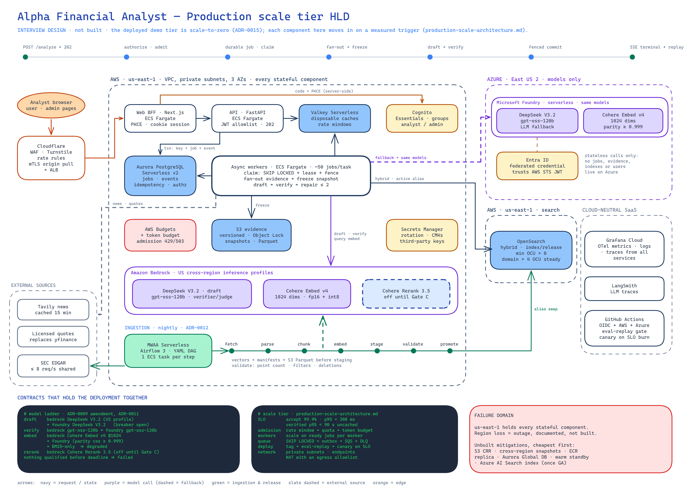
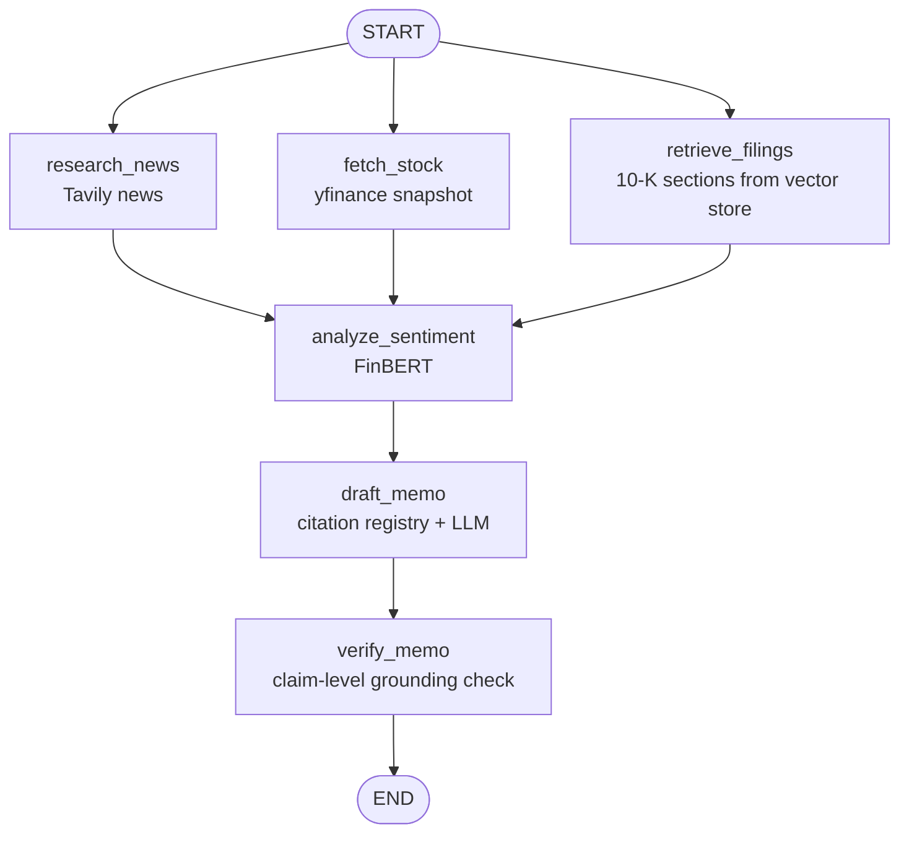
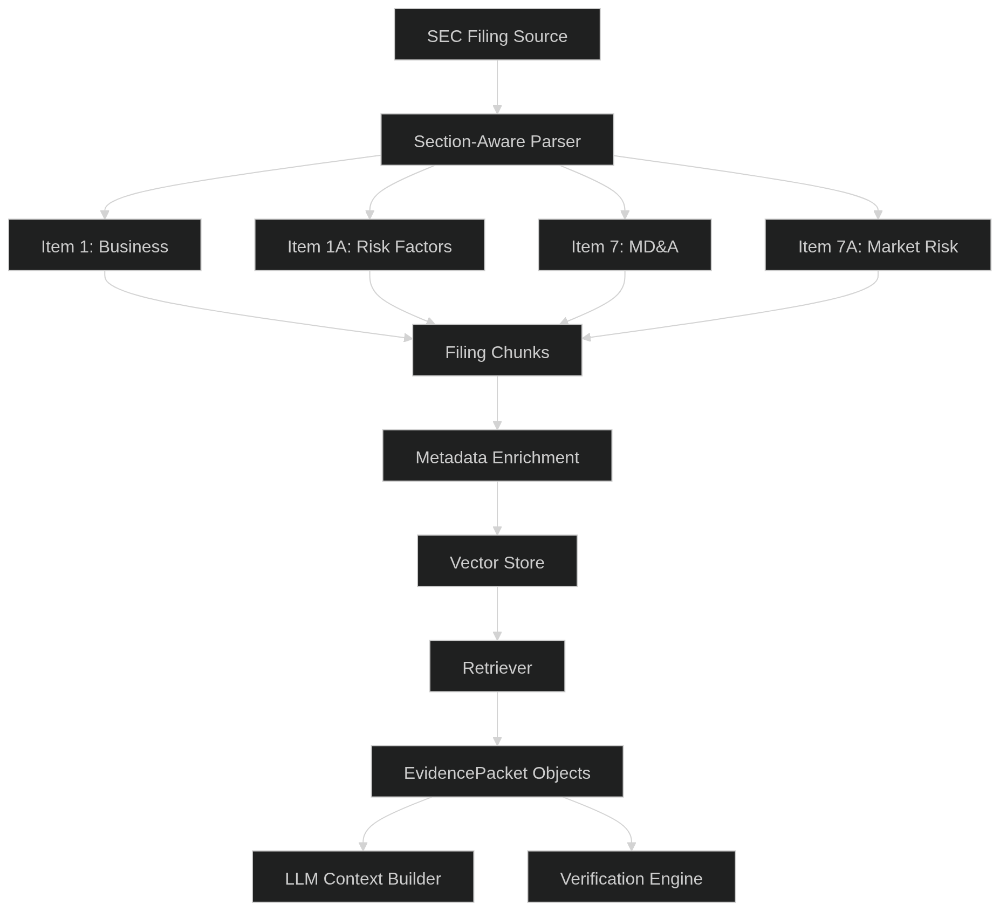
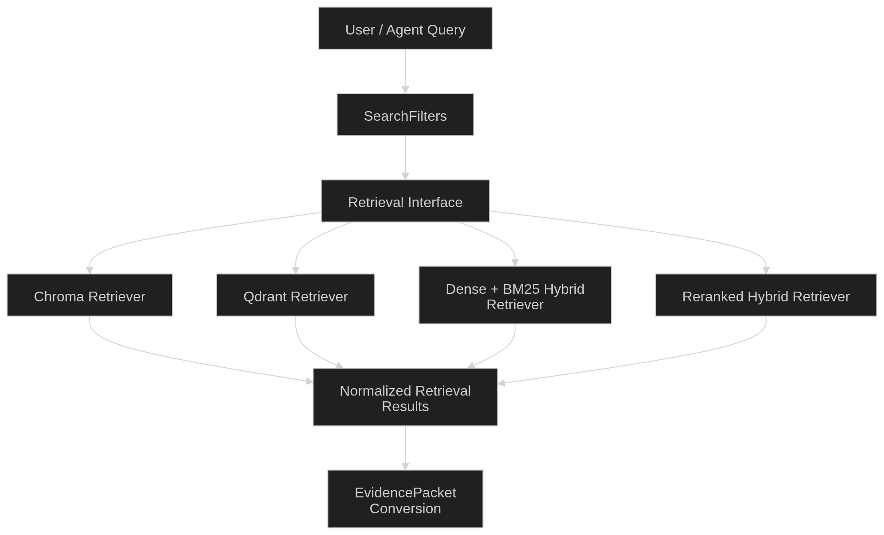
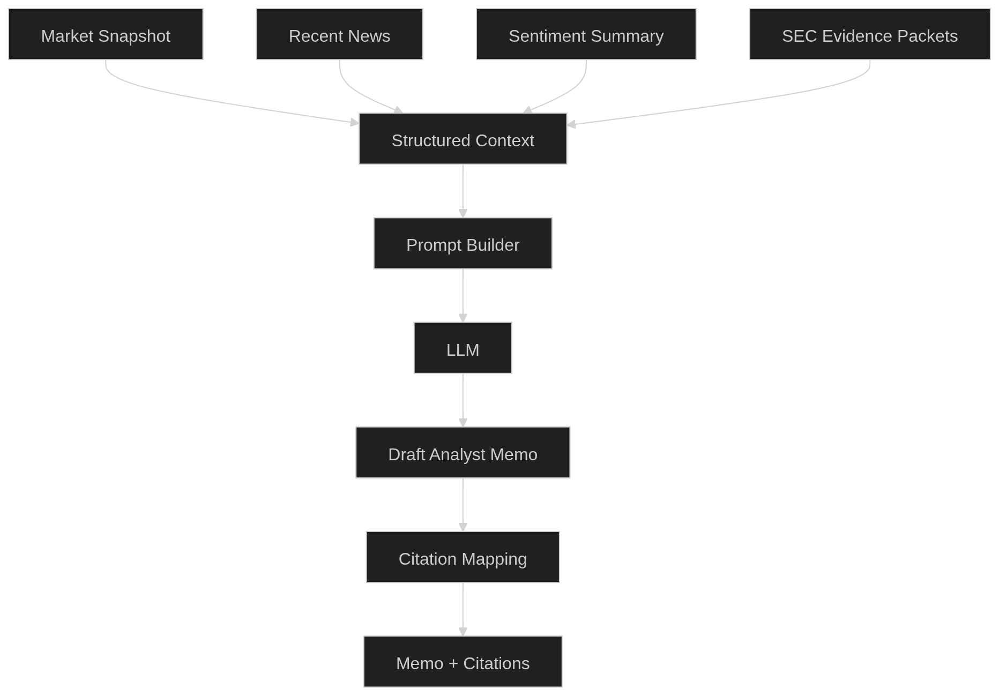
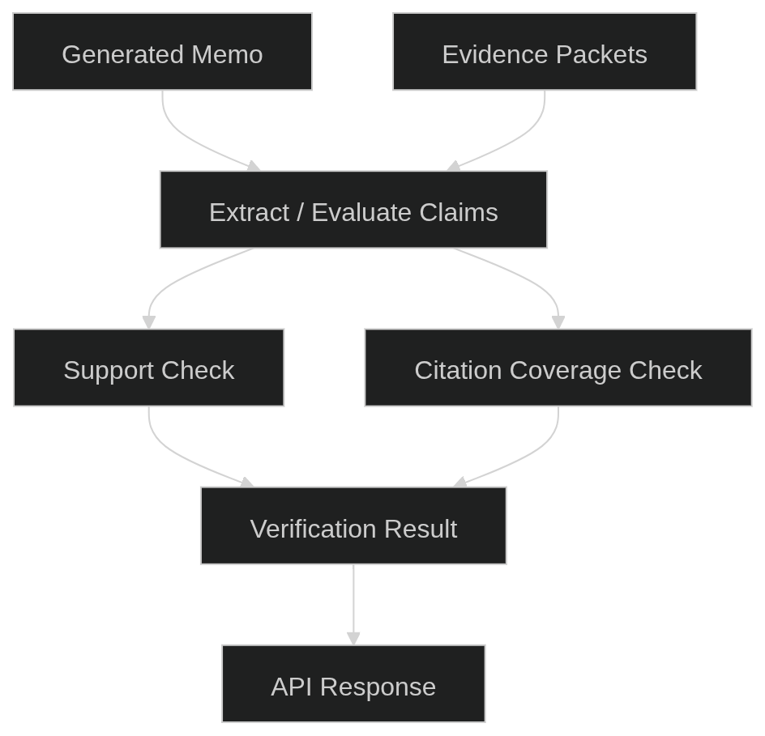
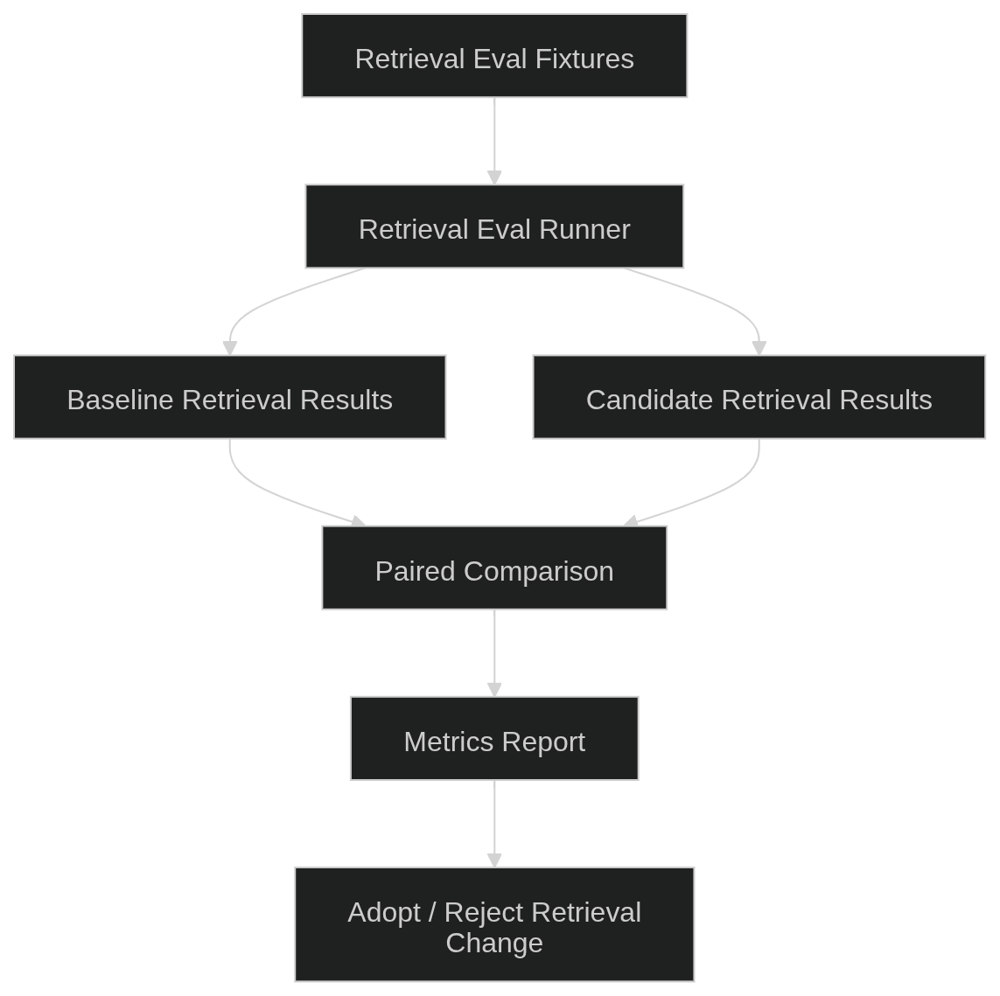
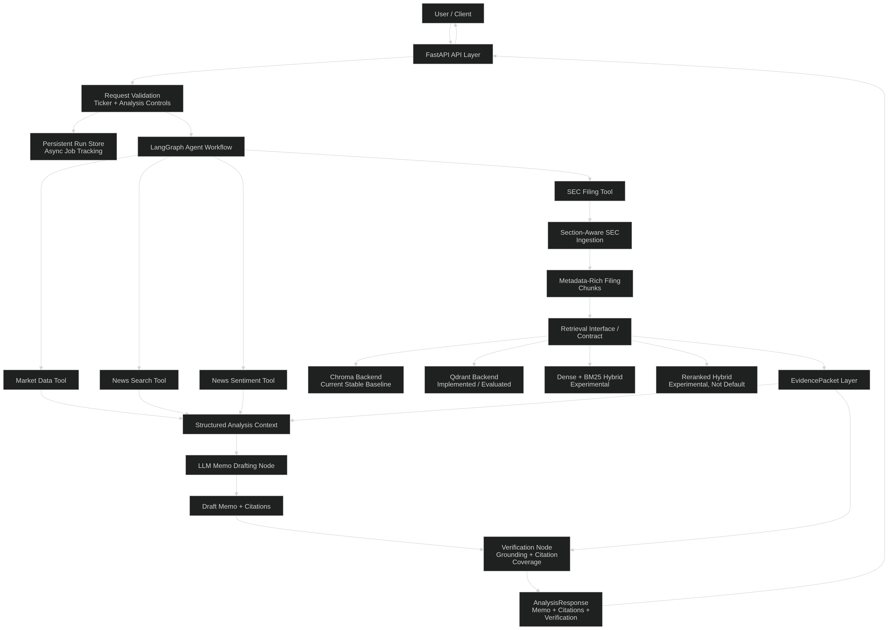

# Financial Analyst Agent

A single-agent financial research system: give it a stock ticker and it gathers market data, recent news and SEC 10-K filing evidence, then writes an investment memo where every factual sentence cites a numbered source. A verifier then checks the memo claim by claim before it is returned.

[](https://www.python.org/downloads/)
[](https://github.com/langchain-ai/langgraph)
[](https://fastapi.tiangolo.com)
[](LICENSE)

**Built with:** LangGraph · FastAPI · Pydantic v2 · Qdrant (Chroma fallback) · Ollama embeddings · Amazon Bedrock chat models (Anthropic/OpenAI fallback) · FinBERT · edgartools · Tavily · yfinance · Prometheus · LangSmith

### What it does

1. **Collects evidence**: recent news (Tavily), a market snapshot (yfinance) and sections of the company's latest 10-K filing (Business, Risk Factors, MD&A, Market Risk) retrieved from a vector store.
2. **Scores sentiment** on the news with FinBERT.
3. **Builds a citation registry**: every source gets a number *before* the model is called, so the model can only cite sources that exist.
4. **Drafts the memo** in seven fixed sections, from executive summary to recommendation.
5. **Verifies the memo**: it extracts factual claims, matches their numbers within a tolerance and checks semantic similarity (≥ 0.45) against the cited evidence. It reports `citation_coverage_rate`, `grounded_claim_rate` and any citations that point to no source.
6. **Serves it all through a FastAPI service** with synchronous and asynchronous endpoints, health checks, statistics and Prometheus metrics.

---

### Measured results

These numbers come from committed artifacts. Each one holds only for the model and inputs listed next to it.

| Measurement | Result | Setup | Source |
|---|---|---|---|
| Grounded-claim rate | **0.935 ± 0.045** | 30 memos (two replay runs of AAPL, MSFT, NVDA × 5), frozen evidence release `alpha-evidence:0.1.0`, `deepseek.v3.2` at temperature 0.3, commit `89265b8` | [`quality_baselines/alpha-quality-baseline__0.1.0.json`](artifacts/dataops/quality_baselines/alpha-quality-baseline__0.1.0.json) |
| Citation coverage | **0.923 ± 0.047** | same run | same file |
| End-to-end latency (warm, sequential) | p50 **32.6 s**, p95 **37.7 s** | 12 warm runs, Ollama `minimax-m3:cloud`, commit `2a47dd1` | [`evaluation/latency_res/`](evaluation/latency_res/) |

### Reproduce the evaluations

```bash
# Memo quality against the frozen evidence release (no live data sources)
uv run python -m evaluation.quality_baseline --evidence-release alpha-evidence:0.1.0

# Sequential latency baseline
uv run python -m evaluation.latency_baseline --tickers AAPL MSFT NVDA --repeats 5

# Run every retrieval method on the shared benchmark, then compare two result files case by case
uv run python -m evaluation.run_shared_retrieval_benchmark --dry-run
uv run python evaluation/compare_retrieval_results.py <baseline.json> <candidate.json> --strict-case-ids
```

Comparisons change one thing at a time: the same fixture, and either the backend or the method, never both. The methodology is in [`docs/retrieval-benchmark.md`](docs/retrieval-benchmark.md).

---

## Architecture

### Cloud architecture: AWS serving, Azure model fallback



One AWS region serves every request and holds all state. Azure hosts the same models as a fallback, so every cross-cloud call is a stateless model request.

- **AWS `us-east-1` serves everything:** Cloudflare in front (WAF, Turnstile, Tunnel), ECS Fargate for the web BFF, API and workers, Aurora PostgreSQL for durable jobs and events, Valkey for disposable caches, S3 for evidence, Cognito for sign-in.
- **Azure is the model plane only:** the same models (DeepSeek V3.2 for drafting, gpt-oss-120b for verification, Cohere Embed v4) on Microsoft Foundry, used as fallbacks behind parity gates.
- **Cloud-neutral services:** Qdrant Cloud for the vector index, Grafana Cloud and LangSmith for observability, GitHub Actions for an eval-gated deploy.
- **Ingestion:** Airflow 3 on MWAA Serverless, one ECS task per pipeline step, promoting a new index release by alias swap only after validation.
- **Cost and teardown:** a $100/month ceiling enforced by an admission cap and an AWS Budgets kill switch; Terraform builds and removes the whole stack.

The decisions behind this design are recorded in [ADR-0006](docs/adr/ADR-0006-production-cloud-deployment.md) and ADR-0010 to ADR-0013. [`docs/cloud-deployment.md`](docs/cloud-deployment.md) has the decision index, request path, degradation ladders, cost model and the region-loss analysis.

| Diagram | Image | SVG | Editable source |
|---|---|---|---|
| Deployment HLD | [`hld.png`](docs/png/production/hld.png) | [`hld.svg`](docs/svg/production/hld.svg) | [`hld.excalidraw`](docs/System-design/production/hld.excalidraw) |
| Critical flow and failover | [`critical-flow.png`](docs/png/production/critical-flow.png) | [`critical-flow.svg`](docs/svg/production/critical-flow.svg) | [`critical-flow.excalidraw`](docs/System-design/production/critical-flow.excalidraw) |
| Contracts (state, caches, releases, identity, gates) | [`lld.png`](docs/png/production/lld.png) | [`lld.svg`](docs/svg/production/lld.svg) | [`lld.excalidraw`](docs/System-design/production/lld.excalidraw) |
| Failure modes, cost and graduation triggers | [`system-design.png`](docs/png/production/system-design.png) | [`system-design.svg`](docs/svg/production/system-design.svg) | [`system-design.excalidraw`](docs/System-design/production/system-design.excalidraw) |

### Agent workflow (current code)

Drawn from `create_agent()` in [`app/agents/graph.py`](app/agents/graph.py). The three evidence nodes run in parallel and join before sentiment. A node that fails records an error and leaves its data empty, and the memo states which data was unavailable. The request's `include_*` options are handled inside the nodes.



### Component diagrams

<details>
<summary><b>Evidence pipeline</b>: how filings, news and market data become citable evidence packets</summary>


</details>

<details>
<summary><b>Retriever architecture</b>: section-aware, hybrid and reranked retrieval behind one store interface</summary>


</details>

<details>
<summary><b>Memo generation</b>: evidence sources merged into a cited memo</summary>


</details>

<details>
<summary><b>Verification flow</b>: claim extraction, number matching and semantic grounding</summary>


</details>

<details>
<summary><b>Evaluation architecture</b>: retrieval benchmarks, quality baselines and LLM-judge metrics</summary>


</details>

<details>
<summary><b>Low-level architecture</b></summary>


</details>

---

## Installation Instructions

### Prerequisites

| Requirement | Needed for |
|---|---|
| Python 3.12 and [`uv`](https://docs.astral.sh/uv/) | everything |
| [Ollama](https://ollama.com) with `qwen3-embedding:4b` | embeddings for ingestion and retrieval |
| AWS credentials with Amazon Bedrock access | the primary chat model (`AWS_BEDROCK_MODEL`) |
| Docker | Qdrant, and the optional API + Prometheus + Grafana stack |
| Tavily API key | news search |
| An SEC contact string (`Name email@example.com`) | SEC EDGAR access |

The offline unit tests need none of the external services.

### 1. Clone and install

```bash
git clone https://github.com/nilesh-auradkar05/Financial-Analyst-Agent.git
cd Financial-Analyst-Agent
uv python install 3.12
uv sync --python 3.12
```

### 2. Configure the environment

Create a `.env` file in the repository root. Settings are read by [`app/config.py`](app/config.py).

```bash
# Primary chat model: Bedrock
AWS_BEDROCK_MODEL=global.anthropic.claude-sonnet-4-6
AWS_REGION=us-east-1
AWS_BEARER_TOKEN_BEDROCK=

# Personal fallbacks: Claude, then OpenAI; each is used only when its key is set
CLAUDE_LLM_MODEL=claude-sonnet-4-5
ANTHROPIC_API_KEY=
OPENAI_LLM_MODEL=gpt-4.1
OPENAI_API_KEY=
LLM_THINKING_MODE=off            # off | enabled | adaptive

# Azure fallback (reserved; not invoked until S7-AZURE-FALLBACK)
AZURE_FOUNDRY_MODEL=

# Ollama (embeddings only)
OLLAMA_BASE_URL=http://localhost:11434
OLLAMA_EMBED_MODEL=qwen3-embedding:4b

# Vector store
VECTOR_BACKEND=qdrant            # or chroma
QDRANT_URL=http://localhost:16333   # standalone Qdrant; omit for the full Docker stack

# Evidence sources
TAVILY_API_KEY=tvly-...
SEC_USER_AGENT="Your Name your-email@example.com"
EDGAR_IDENTITY="Your Name your-email@example.com"

# Optional tracing
LANGSMITH_API_KEY=
```

Set `AWS_BEARER_TOKEN_BEDROCK` for Bedrock API-key authentication (`AWS_BEARER_TOKEN` is an alias), or use the standard AWS credential chain. `CLAUDE_LLM_MODEL` and `OPENAI_LLM_MODEL` select the personal Anthropic and OpenAI fallback models; a fallback whose key is missing is skipped. Each provider attempt is bounded by `LLM_REQUEST_TIMEOUT_SECONDS`. Native traces identify actual attempted models.

There is no provider selector: `AWS_BEDROCK_MODEL` is the only Bedrock model variable and Ollama serves embeddings only. Azure variables (`AZURE_API_KEY`, `AZURE_PROJECT_ENDPOINT`, `AZURE_OPENAI_ENDPOINT`, `AZURE_FOUNDRY_MODEL`) are preserved in Compose, but Azure invocation is deferred to S7-AZURE-FALLBACK. Do not commit `.env`.

Apply code/config changes with `docker compose up -d --build --no-deps api` once active jobs finish. Editing `.env` alone does not update an existing container. Missing filings return a specific ingestion error; analysis can still return available news, prices, sentiment and a memo stating **SEC Filings: Not Available**, with terminal status `evidence_missing`.

For Sonnet 5.5 through Bedrock Converse in `us-east-1`, AWS documents the global inference profile `global.anthropic.claude-sonnet-5-5`; set that explicitly when using global routing. See the [AWS model card](https://docs.aws.amazon.com/us_en/bedrock/latest/userguide/model-card-anthropic-claude-sonnet-5-5.html). Sonnet 5 models use adaptive thinking and do not accept non-default sampling temperatures; the factory omits temperature for them.

Set `API_KEY` in the frontend server environment to the same shared key as the API. The server forwards it to protected backend routes; never expose it through a `NEXT_PUBLIC_` variable.

### 3. Start the local services

```bash
docker compose -p financial-analyst-qdrant-test -f docker-compose.qdrant.yml up -d   # Qdrant on :16333, own volume
ollama pull qwen3-embedding:4b                        # embedding model
```

The standalone Qdrant listens on `:16333`, so a host-run API needs `QDRANT_URL=http://localhost:16333`; the full Compose stack keeps `:6333` and its own volume. See [docs/docker-setup.md](docs/docker-setup.md).

To skip Qdrant, set `VECTOR_BACKEND=chroma`, which stores data locally on disk.

### 4. Check the install

```bash
uv run pytest tests/unit -q
```

The full setup and test walkthrough, including troubleshooting, is in [`docs/setup-and-test.md`](docs/setup-and-test.md).

---

## Usage

### Run the API

```bash
make serve          # uv run uvicorn app.main:app --reload --host 0.0.0.0 --port 8000
make serve-prod     # 4 workers, no reload
```

Interactive API docs: <http://localhost:8000/docs>
Web UI (Compose): <http://localhost:3001>

To run the API with Prometheus (`:9090`) and Grafana (`:3000`) in Docker instead. The stack refuses to start unless `API_KEY`, `SEC_USER_AGENT` and `GRAFANA_ADMIN_PASSWORD` are set in `.env`, and every port is bound to `127.0.0.1`:

```bash
make docker-up
make docker-logs
make docker-down
```

### Endpoints

| Method | Endpoint | Purpose |
|---|---|---|
| `GET` | `/` | Service info |
| `GET` | `/health` | Component health |
| `GET` | `/metrics` | Prometheus metrics |
| `GET` | `/stats` | Vector-store and run-store statistics |
| `POST` | `/ingest` | Ingest a company's SEC filing |
| `GET` | `/ingest/{ticker}` | Check whether a ticker is indexed |
| `POST` | `/analyze` | Run an analysis and wait for the memo |
| `POST` | `/analyze/async` | Start an analysis job; returns a `job_id` |
| `GET` | `/jobs/{job_id}` | Poll a job's status and result |

### Typical flow

1. **Ingest** the ticker's 10-K once (optional). If you skip it, the first analysis of a ticker with nothing indexed ingests the latest 10-K itself, which makes that first run slower.
2. **Analyze** the ticker, either synchronously or as a job.
3. Read the `verification` block in the response to see how well the memo is grounded.

**Analysis request options** (`POST /analyze`, `POST /analyze/async`):

| Field | Default | Meaning |
|---|---|---|
| `ticker` | required | 1–10 characters, e.g. `AAPL` |
| `company_name` | looked up | Optional override |
| `include_filing_analysis` | `true` | Use SEC filing evidence |
| `include_news_sentiment` | `true` | Run FinBERT on the news |
| `max_news_articles` | `10` | 1–50 |

**Ingestion request options** (`POST /ingest`): `ticker` (required), `filing_type` (default `10-K`), `force_refresh` (default `false`).

### Developer commands

```bash
make test           # full test suite
make lint           # ruff
make typecheck      # mypy
make smoke-test     # live end-to-end pipeline for AAPL (needs all services)
```

---

## Examples / Demos

### Ingest, then analyze

```bash
curl -X POST http://localhost:8000/ingest \
  -H "Content-Type: application/json" \
  -d '{"ticker": "AAPL"}'

curl http://localhost:8000/ingest/AAPL

curl -X POST http://localhost:8000/analyze \
  -H "Content-Type: application/json" \
  -d '{"ticker": "AAPL", "max_news_articles": 5}'
```

### Run it as a background job

```bash
curl -X POST http://localhost:8000/analyze/async \
  -H "Content-Type: application/json" \
  -d '{"ticker": "MSFT", "include_news_sentiment": false}'

curl http://localhost:8000/jobs/<job_id>
```

### Response shape

The response is abridged below; the values are placeholders, not real output. The full schema is `AnalysisResponse` in [`app/models.py`](app/models.py).

```json
{
  "ticker": "AAPL",
  "company_name": "Apple Inc.",
  "status": "completed",
  "executive_summary": "…",
  "investment_memo": "## Executive Summary\n… [1][4] …",
  "stock_data": { "current_price": 0.0, "pe_ratio": 0.0, "sector": "…" },
  "sentiment": { "overall_sentiment": "…", "positive_count": 0, "negative_count": 0 },
  "citations": [
    { "index": 1, "source_type": "sec_filing", "title": "…", "url": "…", "date": "…" }
  ],
  "verification": {
    "passed": true,
    "total_claims": 0,
    "citation_coverage_rate": 0.0,
    "grounded_claim_rate": 0.0,
    "orphan_citations": []
  },
  "errors": [],
  "execution_time_ms": 0.0
}
```

---

## License

Released under the [MIT License](LICENSE). Copyright (c) 2025 Nilesh Auradkar.

---

## Contributors and contacts

**Nilesh Auradkar**, author and maintainer
- GitHub: [@nilesh-auradkar05](https://github.com/nilesh-auradkar05)
- Email: nilesh.auradkar14@gmail.com
