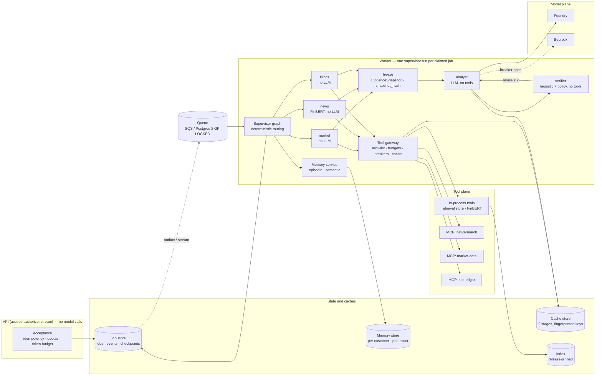
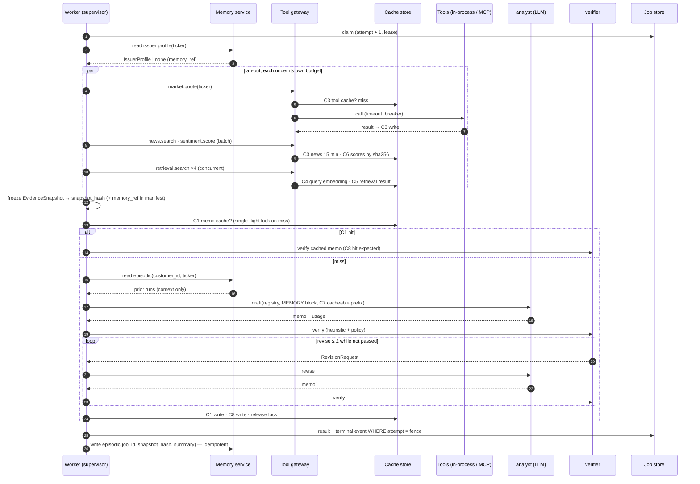
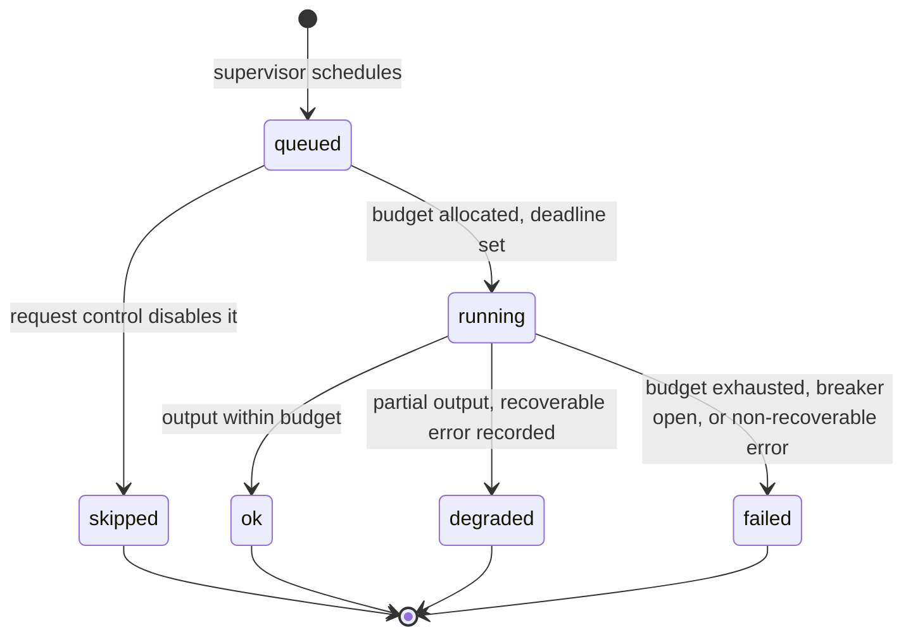
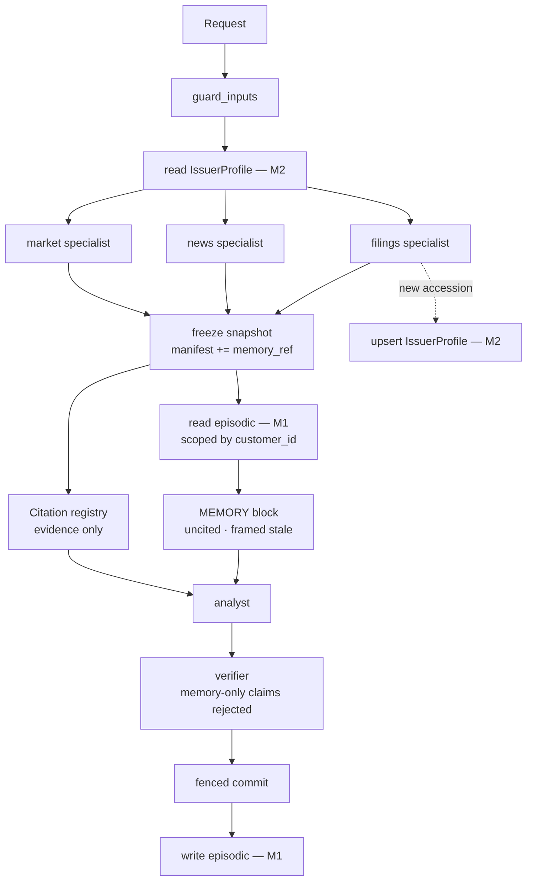
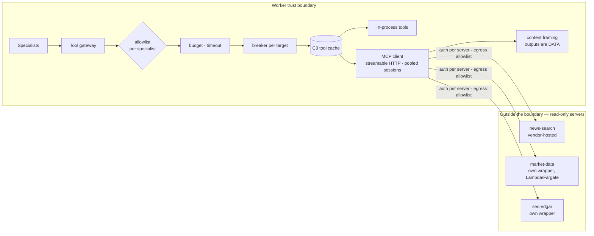
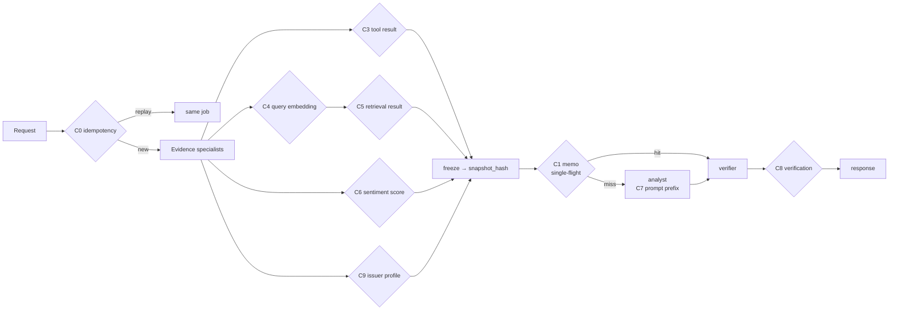
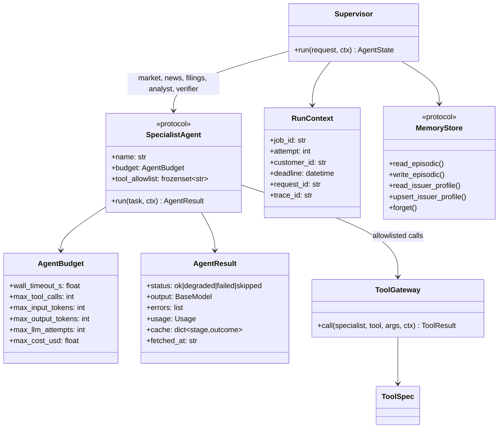

# Agent Architecture Revision — memory, five specialists, MCP, async scale, staged caching, agent NFRs

> **Status:** Design companion for [ADR-0018](adr/ADR-0018-agent-architecture-revision.md) (proposed 2026-11-01 at the owner's request; implementation gated, see §12). Nothing in this document is built. Where it disagrees with SPEC or an accepted ADR, those govern (SPEC §0 rank 6).
>
> **Relation to ADR-0017 (accepted 2026-10-31):** ADR-0017 is the baseline: three agents (Researcher, Analyst, Reviewer), three-tier execution memory (T1–T3), fenced checkpoints, an effect journal and crash resume at the failed agent. This document was first written as "ADR-0016" without that text and was reconciled to it on 2026-11-02 (record renumbered to ADR-0018). The five specialists refine the three agents (`market`, `news`, `filings` split the Researcher); M0 = T1 and M2/M3 live in T3; resume uses ADR-0017's mechanism. **Episodic memory (M1) conflicts with ADR-0017 §1 and is conditional on an owner decision.** Where the two documents disagree, ADR-0017 governs.
>
> **Relation to existing design:** this revision changes the *inside* of one job: how the worker decomposes a memo request, what it remembers between jobs, how it reaches tools, and what it caches. It changes nothing about acceptance, fencing, event replay, identity or deployment, which stay as ADR-0010, ADR-0013 and ADR-0015 define them. The scale tier in [`production-scale-architecture.md`](production-scale-architecture.md) is unchanged; this document is what runs *inside* its workers.
>
> **Verified facts** are marked from code at `HEAD` (`eee2fec`). Numbers are projections from stated formulas unless marked measured.

## 1. Decision

- **Five specialists under a deterministic supervisor.** The LangGraph graph stays code-routed (no LLM planner). It fans out three evidence specialists (`market`, `news`, `filings`), joins and freezes the snapshot, then runs `analyst` and `verifier` in a bounded loop. Each specialist is a typed unit with its own contract, tool allowlist, budget, cache policy, failure semantics and offline eval.
- **Tool-using specialists have no LLM; LLM specialists have no tools.** This split is the prompt-injection containment boundary: untrusted tool output can only reach a model as framed data, and a model can never call a tool.
- **Four memory tiers, one rule.** Working (per job, checkpointed; ADR-0017's T1 and T2), episodic (per principal, per ticker; **conditional on an owner reversal of ADR-0017 §1**), semantic (per issuer, principal-free, provenance-bearing), procedural (versioned prompts and policies, offline-governed). Memory is **context, never evidence**: nothing from memory can carry a citation index, and replay pins the memory items a run read.
- **MCP as the tool plane, behind a gateway.** One `Tool` interface fronts in-process tools and Model Context Protocol servers alike; servers are allowlisted, read-only, schema-pinned and circuit-broken; outputs are untrusted data. The analyst itself is later exposed as an MCP server over the same auth and quotas.
- **Caching at nine stages, every key fingerprinted.** Request idempotency, memo, evidence/tool results, query embeddings, retrieval results, sentiment scores, provider prompt-prefix caching, verification results and issuer profiles. The memo cache is single-flighted. Semantic reuse of memo outputs stays prohibited.
- **Agent NFRs are contracts, not aspirations.** Bounded autonomy (fixed topology, revision cap, tool-call and cost caps per specialist), deadline propagation and cancellation, per-target circuit breakers, a per-specialist degradation ladder, tenant-scoped memory, deterministic replay of tool results, per-agent spans and metrics, and a paired-eval gate (Gate F) before the decomposition replaces the current graph.

## 2. Assumptions and requirements

Verified at `HEAD`:

- The graph has six nodes: `research_news ‖ fetch_stock ‖ retrieve_filings → analyze_sentiment (join + freeze) → draft_memo → verify_memo`; compiled once per process; `errors` uses an append reducer; FinBERT and store calls run under `asyncio.to_thread` (`app/agents/graph.py`, `app/agents/state.py`).
- Only `draft_memo` calls a model. Verification is the heuristic grounding verifier (`app/verification/grounding.py`). The four filing queries run **sequentially** inside `_retrieve_filing_chunks`.
- Replay (`evidence_release`) runs `draft_memo → verify_memo` only and reads no live source (SPEC §7.z).
- No guardrail, cache, memory, queue adapter or MCP code exists; those are S7 and this revision.

Assumptions that shape the design:

- Workload per uncached memo stays ≈ 25.6k tokens (draft 10k in / 2k out, verifier-as-judge 8k in / 0.5k out if adopted, 25% repair rate) and 30–90 s of wall time, almost all of it waiting on model tokens (`production-scale-architecture.md` §3).
- Traffic ladder and cache-hit assumptions are the scale tier's: 10k / 100k / 1M memos per day at 100K / 1M / 10M users; memo-cache hits 20% / 35% / 45%.
- Identity exists before episodic memory: `customer_id` on every job (ADR-0010), guests as `guest:<uuid>` with 24 h sessions (ADR-0015).
- The eval oracle (Gate D, SPEC §11.2) exists before the decomposition is adopted, because the paired comparison that proves "no regression" needs it.
- Correctness invariants are not traded for latency or cost: no `completed` memo without passing verification and output policy; no cited claim without a snapshot source.

## 3. HLD



Design notes:

- **The API never calls a model or a tool.** Admission (rate window, quota, global token budget) happens there; everything else is a worker concern, so capacity is sized in one place.
- **The supervisor is code.** An LLM planner would read tool output to decide what to do next, which is the injection sink this product cannot afford, and it would make runs non-replayable. The topology is fixed; the only data-dependent branch is the verifier's bounded revise loop.
- **The gateway is the only path to a tool.** Specialists hold a tool allowlist, not clients. In-process tools and MCP servers look identical above the gateway, so moving a tool out of process is a configuration change.
- **Memory sits beside the caches, not inside the evidence path.** The memory service reads before fan-out (issuer profile → filings specialist) and before drafting (episodic → analyst); it writes after the fenced terminal commit.
- **Model calls happen in exactly one specialist** (plus the verifier if an LLM judge is adopted under Gate D), so the token budget, prompt caching and the provider ladder (ADR-0009) have a single integration point.

## 4. Critical flow



What the ordering protects: the snapshot is frozen before any model call, so the memo cache key and every citation refer to evidence that can no longer change; memory is written only after the fenced commit, so a stale attempt can never leave a memory record for a result that was discarded.

## 5. Five specialists (per task split)

| Specialist | Replaces (at `HEAD`) | Model call | Tool allowlist | Budget (proposed) | Caches used | Output contract | Failure → run status |
| --- | --- | --- | --- | --- | --- | --- | --- |
| `market` | `fetch_stock` | none | `market.quote`, `market.profile` | 8 s wall, 2 tool calls | C3 (60 s) | `MarketEvidence` | missing → `evidence_missing` (required class) |
| `news` | `research_news` + `analyze_sentiment` | none (FinBERT) | `news.search`, `sentiment.score` | 12 s wall, 2 tool calls, ≤ 50 snippets | C3 (15 min), C6 (permanent by text hash) | `NewsEvidence`, `SentimentEvidence` | missing → `evidence_missing` when enabled |
| `filings` | `retrieve_filings` + ingest on miss | none | `retrieval.search`, `edgar.latest_10k`, `ingest.10k` | 20 s wall + bounded ingest, 4 search calls, 1 ingest | C4, C5, C9 (issuer profile), C3 (SEC until new accession) | `FilingEvidence` (chunk ids, sections, `fetched_at`) | absent 10-K → `filing_not_found`; `evidence_missing` when enabled |
| `analyst` | `draft_memo` (+ `revise_memo`, S6) | yes | none | max input/output tokens, 1 attempt per provider tier, total timeout = tiers × request timeout + 1 (as today) | C1 (memo), C7 (prefix) | `MemoDraft` (memo, used citations, usage, model) | non-recoverable → `failed` |
| `verifier` | `verify_memo` (+ `guard_output`, S7) | none at first; LLM judge only after κ ≥ 0.85 (SPEC §11.2) | none | ≤ 2 revisions, 5 s heuristic | C8 | `VerificationResult`, `RevisionRequest` or approval, `guardrail_events` | not passed after cap → `degraded` |

Why these five and not more: the split follows the evidence classes the product already has (SPEC §8.5 status semantics name them) plus the two roles the repair loop needs. A planner, a summarizer per source or a "critic of the critic" would each add a model call per request without a measured quality need, which SPEC §3 forbids ("broad multi-agent or swarm orchestration").

Changes to the current topology that this implies:

- Sentiment moves inside `news` (it depends only on news), so it overlaps with filings retrieval instead of running after the join. Outputs are unchanged; sentiment still contributes no fetch time (SPEC §7.y).
- The four filing queries run concurrently under one semaphore instead of sequentially.
- The company-name fallback in `filings` reads the issuer profile (memory, C9) before querying the index.

### 5.1 Specialist state machine



Every terminal specialist state carries `usage` (wall ms, tool calls, tokens, cost estimate) and `cache` (hits by stage). `failed` in an evidence specialist never fails the run by itself; the status precedence `failed › evidence_missing › degraded › completed` (SPEC §8.5) decides from the joined evidence.

## 6. Memory architecture

### 6.1 Tiers

| Tier | Scope | Holds | Read by | Written by | Store (demo / scale) | Lifetime |
| --- | --- | --- | --- | --- | --- | --- |
| M0 working | one job | `AgentState`, specialist results, checkpoints | every specialist | supervisor | DynamoDB `checkpoints` / Postgres saver (ADR-0013, ADR-0015) | job + 7 days |
| M1 episodic **(conditional: ADR-0017 §1 excludes it unless the owner reverses that decision)** | `customer_id` × ticker | prior runs: `job_id`, `snapshot_hash`, `evidence_as_of`, status, memo reference, executive summary (≤ 500 chars), verification rates | `analyst` (MEMORY block), API "what changed" | supervisor after fenced commit | DynamoDB `memory` (`ep#{customer_id}#{ticker}`) / Postgres `episodic_memory` with row-level security | 90 days; guests 24 h; delete on request |
| M2 semantic | issuer (principal-free) | `IssuerProfile`: CIK, name, sector, fiscal year end, latest 10-K accession and filing date, section coverage, `source_snapshot_hash`; FinBERT scores by text hash; evidence snapshots and index releases (existing) | `filings`, `news`, freshness checks | `filings` after a successful ingest or retrieval; dataops releases | DynamoDB `memory` (`issuer#{ticker}`) and `cache` / Postgres `issuer_profiles` | until a newer accession; scores permanent per model version |
| M3 procedural | deployment | prompt versions, retrieval configuration, specialist budgets, policy rules, verifier thresholds | all | offline only, through the eval registry (S6, GEPA on holdout) | git + fingerprints in every cache key | per release |

M2 is where memory and caching meet. The design keeps one store and one key scheme for both, so there are not two systems that can disagree about what the system "knows" about an issuer.

### 6.2 Invariants

1. **Memory is context, never evidence.** The analyst receives memory inside a delimited `MEMORY` block framed as "context only; may be stale; do not cite". Memory items have no citation index. The verifier rejects a claim whose only support is memory text, exactly as it rejects an orphan citation.
2. **Replay is deterministic.** The snapshot manifest records `memory_ref` (sha256 over the canonical JSON of the memory items read). A replay reuses those items and never reads the live memory store. Evaluation runs read no memory unless the fixture pins it, so quality baselines stay comparable.
3. **Tenant isolation.** M1 is keyed by `customer_id` and authorized as data (ADR-0010 §4). Guests get session-scoped episodic memory with the session's 24 h TTL. M2 holds no principal data by construction (its schema has no `customer_id`).
4. **Freshness over recall.** A "what changed since your last memo" delta is computed by code from the current snapshot against the prior episodic record, and only when the prior `snapshot_hash` differs. Prior values appear in the MEMORY block; current values are cited to current evidence.
5. **Nothing user-written persists** beyond ticker, company name and request controls, which input guardrails already bound (SPEC §11.4).
6. **Write-after-commit, idempotent on `job_id`.** A memory write for a job whose fenced commit failed is impossible; a repeated write is a no-op.
7. **Memory unavailable is a degradation, not a failure.** The run proceeds without memory and records `memory_unavailable` in `guardrail_events`; the response's `memory` field is empty.

### 6.3 Data flow



### 6.4 Interface and schemas

```python
class PrincipalId(BaseModel, extra="forbid"):
    customer_id: str          # "guest:<uuid>" or a Cognito subject

class EpisodicRecord(BaseModel, extra="forbid"):
    customer_id: str
    ticker: str
    job_id: str
    snapshot_hash: str
    evidence_as_of: str | None
    status: Literal["completed", "degraded", "evidence_missing"]
    memo_ref: str             # artifact reference, never the memo text
    executive_summary: str    # ≤ 500 chars
    grounded_claim_rate: float
    citation_coverage_rate: float
    created_at: str
    expires_at: str

class IssuerProfile(BaseModel, extra="forbid"):
    ticker: str
    cik: str | None
    company_name: str
    sector: str | None
    fiscal_year_end: str | None
    latest_10k_accession: str | None
    latest_filing_date: str | None
    section_coverage: dict[str, int]
    source_snapshot_hash: str
    updated_at: str

class MemoryStore(Protocol):
    async def read_episodic(self, principal: PrincipalId, ticker: str, *, limit: int = 3) -> list[EpisodicRecord]: ...
    async def write_episodic(self, record: EpisodicRecord) -> None: ...          # idempotent on job_id
    async def read_issuer_profile(self, ticker: str) -> IssuerProfile | None: ...
    async def upsert_issuer_profile(self, profile: IssuerProfile) -> None: ...  # last-writer by updated_at
    async def forget(self, principal: PrincipalId) -> int: ...                  # count deleted
```

Adapters: `InMemoryMemoryStore` (tests), `DynamoDBMemoryStore` (demo tier, DynamoDB Local in compose), `PostgresMemoryStore` (scale tier, not built until its ADR-0015 trigger). The protocol lives in `app/memory/`; no store client escapes it.

API surface (additive): `AnalysisResponse.memory` with `prior_run` (`job_id`, `evidence_as_of`, `snapshot_hash`) and `delta` (list of `{field, previous, current, citation_index}`); `DELETE /memory` scoped to the caller's `customer_id` (returns the count), `admin` only for `DELETE /memory/issuers/{ticker}`.

## 7. MCP integration plan

### 7.1 Consume: the tool gateway



Contract:

```python
class ToolSpec(BaseModel, extra="forbid"):
    name: str                     # "news.search"
    server: str | None            # None = in-process
    input_schema: dict            # JSON schema, validated with extra="forbid"
    output_schema: dict
    schema_hash: str              # sha256 over name + description + both schemas, pinned in config
    ttl_class: Literal["market", "news", "sec", "permanent", "none"]
    timeout_s: float
    max_concurrency: int
    side_effects: Literal["none"] # only read-only tools are registrable

class ToolResult(BaseModel, extra="forbid"):
    tool: str
    schema_hash: str
    fetched_at: str
    cache: Literal["hit", "miss", "bypass"]
    payload: dict                 # validated against output_schema, then framed as untrusted content

class ToolGateway(Protocol):
    async def call(self, specialist: str, tool: str, args: dict, *, ctx: RunContext) -> ToolResult: ...
```

Rules:

- **Static registry.** Servers and tools come from Pydantic settings (`MCPSettings`: name, URL, credential reference in Parameter Store, allowed tools, pinned `schema_hash`, timeout, concurrency). No discovery at runtime; a server's `tools/list` is compared with the pinned hashes at startup and a drifted tool is disabled with a logged `tool_schema_drift` event until re-approved. This is the mitigation for tool poisoning and rug-pull changes to descriptions.
- **Read-only only.** A tool that writes, trades, sends or deletes cannot be registered; the schema field makes the rule structural.
- **Server-initiated requests are refused.** Sampling and elicitation callbacks from servers are disabled in the client; a server cannot make the worker call a model.
- **Outputs are data.** Every payload passes through the untrusted-content framing of SPEC §11.4 before any specialist uses it, and only specialists without a model ever receive raw payloads.
- **Transport.** Streamable HTTP with pooled sessions per server per process; stdio only for local development. Each call carries the job's correlation IDs; the `fetched_at` of a result feeds `evidence_as_of` exactly as today's tools do.
- **Deployment.** Own wrappers (`market-data`, `sec-edgar`) run as separate functions or tasks outside the worker's execution role, with their own egress allowlist; vendor-hosted servers (news search) are reached through NAT in the scale tier. The worker's role gains no new permission.
- **Replay.** The evidence release gains a `tool_calls` log (`tool`, `schema_hash`, `args_hash`, `payload_hash`), so a replay can assert that a specialist asked for the same things, not only that the memo is the same.

Candidate servers and the order they are adopted, each behind a feature flag and a paired evidence-equality check:

| Order | Server | Replaces | Why first / later |
| --- | --- | --- | --- |
| 1 | `news-search` (vendor-hosted; the current search provider publishes one) | `search_company_news` | Lowest risk: already an external HTTP tool; evidence equality is easy to assert |
| 2 | `sec-edgar` (own wrapper) | filing discovery in ingest on miss | Moves EDGAR rate limiting out of the worker (ADR-0012 limiter); parsing stays in-process with `edgartools` |
| 3 | `market-data` (own wrapper) | `get_stock_data` | Vendor swap behind one schema when licensed data arrives (ADR-0012 D15) |

### 7.2 Expose: the analyst as an MCP server

The API mounts an MCP server at `/mcp` (streamable HTTP) with tools `analyze_ticker` (returns `job_id`; same request schema), `get_job`, `list_runs`, and a resource `memo://{job_id}`. It is a thin adapter over the existing routes: same issuer allowlist and API keys, same quotas, same typed error envelope, same `Cache-Control: no-store`. It never bypasses acceptance, so an agent client (IDE, desktop assistant, another orchestrator) costs the same as a browser.

### 7.3 Phasing

| Phase | Change | Validation |
| --- | --- | --- |
| MCP-0 | Gateway with in-process tools only; per-specialist allowlists; budgets; C3 cache; metrics | Replay byte-identical registries; `tool_calls` log added to the release; no behavior change |
| MCP-1 | `news-search` server behind a flag | Paired evidence-equality check on 20 tickers (same titles/URLs/snippets within the TTL window); breaker drill |
| MCP-2 | `sec-edgar` wrapper | Ingest-on-miss parity on the three fixture tickers; limiter never exceeds 8 req/s |
| MCP-3 | Expose `/mcp` | Auth, quota and error-envelope tests reuse test-plan §1 cases |
| MCP-4 | `market-data` wrapper | Vendor parity on the quote fields the registry uses |

## 8. Async execution at scale

What stays (scale tier, unchanged): API-only admission against a global token budget, fenced claims, worker autoscaling on queue age, per-job deadline and cost cap, Lambda one-job-per-environment in the demo tier and ~50 concurrent jobs per Fargate task in the scale tier.

What this revision adds inside the worker:

| Concern | Mechanism | Bound |
| --- | --- | --- |
| Specialist concurrency | Supervisor fans out `market`, `news`, `filings` as LangGraph branches; inside `filings`, the four searches run under `asyncio.gather` with a semaphore | per-specialist `max_concurrency` |
| Tool concurrency | One `asyncio.Semaphore` per tool target per process (e.g. `news-search` 4, `retrieval.search` 16, provider 8) | from `ToolSpec.max_concurrency` |
| Provider throughput | Token-bucket counter `tok:{provider}:{minute}` (Valkey / DynamoDB) checked before each model call; admission refuses at 80% of quota | provider TPM |
| Deadlines | `asyncio.timeout` per tool < per specialist < job deadline; cancellation propagates through task groups; a cancelled specialist records `failed(cancelled)` and releases its semaphore | job deadline 10 min |
| Blocking libraries | `yfinance`, `edgartools`, FinBERT (PyTorch locally, ONNX in the Lambda worker) stay behind `to_thread` with a bounded pool; no sync call on the loop (SPEC §8.2) | pool size = 2 × vCPU |
| Resume after crash | ADR-0017's mechanism, unchanged: fenced checkpoints per super-step, an effect journal for every model and tool call, and handoff envelopes; a re-claimed attempt resumes at the specialist that was running and reuses journaled results; the snapshot is frozen once and read by hash afterwards | attempt < 3 |
| Backpressure | Queue age and ready-jobs-per-worker drive autoscaling; per-worker in-flight cap; 429 with `Retry-After` at admission, never an unbounded backlog | ready / (tasks × 50) |
| Duplicate work | Request idempotency (C0), memo single-flight (C1), tool-result cache (C3) collapse identical work at three granularities | lock TTL = generation deadline |
| Streaming | Progress events gain `agent` and `cache` fields; the `progress` contract (SPEC run telemetry) stays additive | 15 s heartbeat |

Expected latency, uncached, p95 targets per phase (sum ≤ 90 s, the scale tier SLO):

| Phase | Budget | Why |
| --- | --- | --- |
| Evidence fan-out | ≤ 20 s (max of specialists, not sum) | `filings` is the slowest; ingest on miss is excluded from the SLO and reported as a `warming`-class event |
| Freeze + memory + registry | < 1 s | CPU only |
| Draft | ≤ 45 s | Model-bound; tracked per model |
| Verify (heuristic + policy) | ≤ 5 s | CPU only |
| One revision | ≤ 45 s + 5 s | Only on the repair path; p95 assumes ≤ 1 revision |

## 9. Caching stages



| Stage | Key | Lifetime | Saves | Invalidated by | Metric label |
| --- | --- | --- | --- | --- | --- |
| C0 request idempotency | `customer_id` + `Idempotency-Key` → request hash (ADR-0013) | 7 days | the whole job | different request hash → 409 | `idempotency` |
| C1 memo | `memo:{snapshot_hash}:{prompt_version}:{model_fp}:{verifier_policy_fp}` | snapshot validity | draft + revisions (all model calls) | any fingerprint change; new snapshot | `memo` |
| C2/C3 evidence and tool results | `tool:{server}:{tool}:{schema_hash}:{args_hash}` (generalizes `ev:` keys) | market 60 s · news 15 min · SEC until new accession | tool calls, vendor cost, EDGAR budget | TTL class; schema drift | `tool` |
| C4 query embedding | `qe:{embedding_fp}:{sha256(normalized_query)}`, exact only | release lifetime | embedding calls | new embedding model | `query_embedding` |
| C5 retrieval result | `rr:{index_release}:{retrieval_cfg_fp}:{query_hash}:{filter_hash}` | release lifetime | search calls, OCU minutes | new release or config | `retrieval` |
| C6 sentiment | `(sha256(text), model_version)` | permanent | FinBERT inference | model version | `sentiment` |
| C7 provider prompt prefix | provider-side: cacheable system prompt + instructions placed first; semi-static issuer profile next; registry last | provider TTL (minutes) | 30–60% of draft input tokens on repeats within the window | prompt version | `prompt_prefix` (reported from provider usage, never estimated) |
| C8 verification | `ver:{sha256(memo)}:{registry_hash}:{verifier_policy_fp}` | snapshot validity | re-verifying a cached memo; repeated loops | verifier policy | `verification` |
| C9 issuer profile (M2) | `issuer:{ticker}` | until new accession | name lookup query, freshness probe | new accession | `issuer_profile` |

Prohibited, unchanged: semantic similarity caching of memo outputs across different snapshots (SPEC §11.3). Every stage exposes `cache_events_total{stage, outcome ∈ hit|miss|bypass|wait}` in `/metrics`.

Projected calls per request (formula, not measurement): with memo hit rate `h`, repair rate `r` and no LLM judge, model calls per request = `(1 − h) × (1 + r)`; at `h = 0.35, r = 0.25` that is 0.81, against 1.25 today once the repair loop exists. Tool calls per request = `Σ_source (1 − h_source) × calls_source`; with the TTLs above and an earnings-day burst on one ticker, the market and news sources collapse to one call per TTL window per ticker regardless of request count. C7 reduces input tokens on cache misses, not call count; its saving is reported from provider usage metadata only.

## 10. NFR hardening specific to AI agents

| NFR | Control | Observable |
| --- | --- | --- |
| Bounded autonomy | Fixed topology; revision cap 2; tool-call cap and cost cap per specialist; job cost cap → typed `failed(cost_cap_exceeded)` | `agent_budget_exhausted_total{agent, kind}` |
| Timeouts and cancellation | Tool < specialist < job deadline; cancellation propagates; no orphan tasks after a job ends | `agent_duration_seconds{agent}`; `orphan_tasks` gauge = 0 |
| Fault isolation | Breaker per provider (ADR-0009 ladder) and per MCP server; half-open probes; a failed evidence specialist degrades the run per its ladder row, never crashes it | `breaker_state{target}` |
| Degradation ladder | `market` failed → `evidence_missing`; `news` failed → memo states news unavailable, `evidence_missing` when enabled; `filings` absent → `filing_not_found` + "SEC Filings: Not Available"; `analyst` failed on every tier → `failed(provider_unavailable)`; `verifier` not passed after cap → `degraded`; memory down → run continues, `memory_unavailable` event | `run_status_total{status, cause}` |
| Prompt-injection containment | Tool-using specialists have no model; model specialists have no tools; memory never cites; tool outputs framed as data; tool schemas pinned; no server-initiated model calls; output policy before exposure | `guardrail_events` in every response |
| Tenant isolation | `customer_id` on episodic memory, jobs, events, idempotency; row-level security in the scale tier; guests 24 h TTL; `DELETE /memory` | cross-customer tests (test-plan §23.2, conditional) |
| Determinism and replay | Snapshot before any model call; `memory_ref` and `tool_calls` in the manifest; replay reads no live tool or memory | replay suite byte-identical |
| Idempotency and exactly-one result | ADR-0013 fencing unchanged; specialist checkpoints make a retried attempt cheaper, not different | `fence_rejections_total` |
| Capacity | Admission against provider TPM; worker count derived from the token quota; per-target semaphores | `tokens_per_minute{provider}` vs quota |
| Quality drift | Sampled live runs scored against the approved baseline (`grounded_claim_rate`, `citation_coverage`); per-specialist evals in CI on the frozen release | drift alert at 2σ |
| Model and prompt change control | M3 is offline-only; every change is a new `prompt_version` or `model_fp`, so caches miss and the eval gate runs | eval registry lineage (SPEC §11.2) |
| Cost ceilings | Per-job cap, per-customer quota, global budget kill switch (ADR-0015) | `cost_per_memo{model}` |
| Human review path | Memos rewritten by the output policy and runs ending `degraded` are listed for `admin` with their `guardrail_events`; nothing is auto-published that the policy rewrote without an event | admin list filter |

Game days added to the scale tier's list: kill a specialist mid-fan-out (run completes with the ladder's status), MCP server returns a drifted schema (tool disabled, run degrades), memory store down (run completes without memory), provider 429 storm (breaker opens, fallback tier, no spliced drafts), burst of identical requests (one generation, N linked results).

### 10.1 Proposed SLOs (additions to the scale tier's §7.3)

| SLO | Target |
| --- | --- |
| Evidence phase p95 (uncached, ingest excluded) | < 20 s |
| Memo-cache hit served p95 | < 2 s (unchanged) |
| Memory read p99 | < 50 ms, and never on the critical path when unavailable |
| Tool-schema drift to disable | < 1 startup |
| Correctness invariants | 0 cited claims without a snapshot source; 0 memory-sourced citations; 0 `completed` without passing verification and policy |

## 11. LLD

### 11.1 Module layout (SPEC §5 additions)

```text
app/agents/
  supervisor.py        # graph construction; fixed topology; routing by verifier result only
  context.py           # RunContext: job_id, attempt, customer_id, deadline, budgets, correlation ids
  specialists/
    base.py            # SpecialistAgent protocol, AgentBudget, AgentResult, AgentStatus
    market.py news.py filings.py analyst.py verifier.py
app/tools/
  gateway.py           # ToolGateway: allowlist, budget, breaker, C3 cache, framing
  registry.py          # ToolSpec registry from MCPSettings; schema-hash pinning
  inprocess.py         # retrieval.search, sentiment.score, ingest.10k adapters
  mcp_client.py        # streamable-HTTP client, pooled sessions, callbacks disabled
app/mcp/
  server.py            # /mcp exposure: analyze_ticker, get_job, list_runs, memo resource
app/memory/
  store.py             # MemoryStore protocol, schemas
  dynamodb.py inmemory.py
  context.py           # MEMORY block rendering, delta computation
app/cache/             # as SPEC §5: stages C1–C9, single-flight, metrics
```

Dependency rules: `specialists/*` import `app/tools/gateway.py` and `app/memory/store.py`, never a client; `app/tools/mcp_client.py` is the only module importing the MCP SDK; `app/mcp/server.py` imports `app/main.py` routes' services, never the graph directly; `evaluation/` may import any of these, never the reverse.

### 11.2 Class diagram



### 11.3 Supervisor topology (SPEC §8.1 as revised)

```text
START → guard_inputs → memory_read_issuer
      → [market ‖ news ‖ filings]            (fan-out; news includes sentiment)
      → freeze_snapshot (manifest += memory_ref, tool_calls)
      → memo_cache_lookup
          hit  → verifier
          miss → memory_read_episodic → analyst → verifier
      → (passed | revisions ≥ 2) ? guard_output → persist → memory_write → END
                                 : analyst(revise) → verifier
```

Replay topology: `memo_cache_lookup → analyst → verifier → guard_output` with memory and tool calls read from the release manifest.

### 11.4 Error handling

- Every boundary raises a typed error (`ToolError{code, tool, retryable}`, `BudgetExceeded{kind}`, `MemoryUnavailable`, `ProviderUnavailable`); specialists convert them into `AgentResult.status` and an `errors` entry with a safe message; nothing propagates raw provider or vendor text (test-plan §1 T2-07 unchanged).
- Breaker state is per process in the demo tier (one job per environment) and shared through the cache store in the scale tier.
- A tool payload that fails output-schema validation is a `ToolError(invalid_payload)`: it is dropped, never partially used.

### 11.5 Concurrency behavior

- The supervisor never awaits a specialist outside its budget; `asyncio.timeout` wraps `run()`; on timeout the task group cancels the specialist's children.
- The memo single-flight lock is acquired after the freeze and released in `finally`; a waiter that times out generates itself (degrades to a duplicate model call, recorded as cost).
- Memory writes are fire-after-commit with a bounded retry; failure is logged, never raised to the job.

## 12. Implementation plan

Entry criteria for any phase beyond A: S7.1–S7.12 recorded (guardrails, identity, ADR-0017's checkpoints, journal, error taxonomy and three agents, job store and queue, caches, breaker, execution observability) and Gate D (eval registry and regression gate), because the adoption decision is a paired comparison. Each phase is a behavior-preserving step until Gate F.

| Phase | Task | Change | Validation before the next phase |
| --- | --- | --- | --- |
| A | S7.1–S7.12 | Existing seams and ADR-0017: guardrails, auth, fenced checkpoints, effect journal, three agents, caches C1/C2/C4/C5/C6, `RunStore`/`JobQueue`, breaker | S7 verification as planned; R6 resume matrix green |
| B | S11-T01 | `SpecialistAgent` protocol; ADR-0017's Researcher split into `market`, `news` and `filings`, with the Analyst and Reviewer becoming `analyst` and `verifier` under the supervisor; sentiment inside `news`; concurrent filing queries | Replay registries byte-identical; test-plan §10 fan-out cases still pass; no new model call |
| C | S11-T02 | Tool gateway with in-process tools, allowlists, budgets, C3, `tool_calls` in the release manifest (MCP-0) | Zero-network replay passes; every specialist's tool calls are within allowlist; metrics present |
| D | S11-T03 | Cache stages C7, C8, C9 with metrics | Each fingerprint change misses; provider-reported cached tokens appear in `usage` |
| E | S11-T04 | Memory store M1/M2, MEMORY block, delta, verifier rule, `DELETE /memory`, replay pins `memory_ref` | Cross-customer and guest-TTL cases; memory-only claim rejected; memory-down run completes |
| F | S11-T05 | MCP-1 and MCP-2 servers behind flags | Paired evidence-equality checks; breaker and schema-drift drills |
| G | S11-T06 | `/mcp` exposure (MCP-3) | Auth, quota and envelope cases reuse §1 |
| H | S11-T07 | Gate F: paired comparison of the specialist graph against ADR-0017's three-agent graph on the frozen release, same model, temperature and prompt (single-axis rule); game days | No regression of `grounded_claim_rate` or `citation_coverage` beyond tolerance; every drill ends in its documented status |

Gate F is the adoption decision. Until it passes, ADR-0017's three-agent graph stays the default and the specialist graph runs behind a flag.

## 13. Security and cost

| Risk | Control |
| --- | --- |
| Tool poisoning or rug-pull through an MCP server's descriptions | Schema and description hashes pinned in configuration; drift disables the tool; no runtime discovery |
| Server-initiated model calls | Sampling and elicitation disabled in the client |
| Injection through tool payloads | Only model-free specialists receive payloads; framing before any model sees them; output policy before exposure |
| Cross-customer memory leakage | `customer_id` keying, row-level security in the scale tier, no principal field in M2, `DELETE /memory` |
| Stale memory presented as fact | MEMORY block uncited and framed stale; verifier rejects memory-only claims; delta computed by code |
| Credential sprawl across servers | Per-server credentials in Parameter Store, workload roles, egress allowlist; the worker's role is unchanged |
| Cost blow-up from loops or retries | Fixed topology, revision cap, per-specialist and per-job cost caps, token-budget admission, kill switch |

Cost deltas against the scale tier's projection: memory storage is negligible (one small item per run); own MCP wrappers add two always-free Lambda functions in the demo tier or two small Fargate tasks in the scale tier (≈ $60/month); C7 reduces draft input cost on misses by the provider's cached-token discount, measured, not assumed; the paired Gate F runs are the one new eval cost, bounded by the frozen release size.

## 14. Risks and alternatives

| Alternative | When it would be preferable |
| --- | --- |
| LLM supervisor / planner (ReAct over tools) | Open-ended research tasks with unknown tool sequences; not a fixed memo with a fixed evidence set |
| Per-source LLM summarizers before drafting | If the registry exceeds the draft model's useful context; measured on the eval set, not assumed |
| Vector-indexed episodic memory (semantic recall over prior memos) | Many tickers per user and cross-ticker questions; today the lookup key is exact (`customer_id`, ticker) |
| Runtime MCP discovery | A marketplace of tools with a human approving each; this product has three read-only sources |
| Two caches (memory and cache stores) | Never; one store with fingerprinted keys avoids disagreement about what is known |
| Exposing `/mcp` first | If agent clients are the main audience; here the browser is, so consumption comes first |

Main risks: the decomposition changes memo quality in a way the heuristic verifier cannot see (mitigated by Gate F with the judge where κ allows); MCP servers add a dependency per evidence class (mitigated by breakers, the ladder and keeping in-process adapters as fallbacks); memory tempts the model to restate stale facts (mitigated by the uncited block, the verifier rule and the code-computed delta); scope creep toward "swarm" orchestration (bounded by SPEC §3 wording: exactly five specialists, deterministic supervisor).

## 15. Final recommendation

Decide the episodic-memory conflict with ADR-0017 §1 first. Then accept ADR-0018 as a refinement of ADR-0017, keep it gated on S7.1–S7.12 and Gate D, and build it in the order of §12: refactor to five specialists with no behavior change first, then the gateway, then caches, then memory, then MCP, and adopt only on a paired Gate F result. The next engineering action is S11-T01 after S7 (e), and the next decision for the owner is the acceptance of the ADR and the SPEC v1.5 scope amendment it carries.

## 16. Diagrams

The Mermaid diagrams in §§3, 4, 5.1, 6.3, 7.1, 9 and 11.2 are inline companions. The set below was authored with Archify (editable JSON sources, interactive HTML, light-theme SVG and PNG renders). **It draws this proposal (ADR-0018), not the accepted ADR-0017 baseline:** it shows five specialists and an episodic memory store, which ADR-0017 does not have; ADR-0017's crash resume is drawn in Mermaid in `cloud-deployment.md` §3.1. The titles were re-rendered with the ADR-0018 number on 2026-11-02. The HTML pages passed Archify's automated validation, delivery, strict provenance and browser gates and were inspected visually at 2048 px; the SVG and PNG files are exports of the same artifacts.

| Diagram | Editable source | Interactive | Renders |
| --- | --- | --- | --- |
| Agent HLD (§3) | [`hld.archify.json`](System-design/agents/hld.archify.json) | [`hld.html`](System-design/agents/hld.html) | [`png`](png/agents/hld.png) · [`svg`](svg/agents/hld.svg) |
| Critical flow and attempt 2 after a crash (§4, §8) | [`critical-flow.archify.json`](System-design/agents/critical-flow.archify.json) | [`critical-flow.html`](System-design/agents/critical-flow.html) | [`png`](png/agents/critical-flow.png) · [`svg`](svg/agents/critical-flow.svg) |
| LLD: specialist protocol, gateway and memory contracts (§11) | [`lld.archify.json`](System-design/agents/lld.archify.json) | [`lld.html`](System-design/agents/lld.html) | [`png`](png/agents/lld.png) · [`svg`](svg/agents/lld.svg) |
| Analysis job lifecycle (§5.1, SPEC §8.5) | [`run-lifecycle.archify.json`](System-design/agents/run-lifecycle.archify.json) | [`run-lifecycle.html`](System-design/agents/run-lifecycle.html) | [`png`](png/agents/run-lifecycle.png) · [`svg`](svg/agents/run-lifecycle.svg) |
| Memory tiers and cache stages (§6, §9) | [`memory-cache-dataflow.archify.json`](System-design/agents/memory-cache-dataflow.archify.json) | [`memory-cache-dataflow.html`](System-design/agents/memory-cache-dataflow.html) | [`png`](png/agents/memory-cache-dataflow.png) · [`svg`](svg/agents/memory-cache-dataflow.svg) |
| MCP tool plane and trust boundary (§7) | [`mcp-tool-plane.archify.json`](System-design/agents/mcp-tool-plane.archify.json) | [`mcp-tool-plane.html`](System-design/agents/mcp-tool-plane.html) | [`png`](png/agents/mcp-tool-plane.png) · [`svg`](svg/agents/mcp-tool-plane.svg) |

Two deliberate simplifications in the drawings: the HLD shows the two first MCP servers and names the later `market-data` wrapper in a card, and the lifecycle folds the claim into the first transition (claim = attempt + 1, lease, guard_inputs, issuer-profile read) to stay within desktop width.
