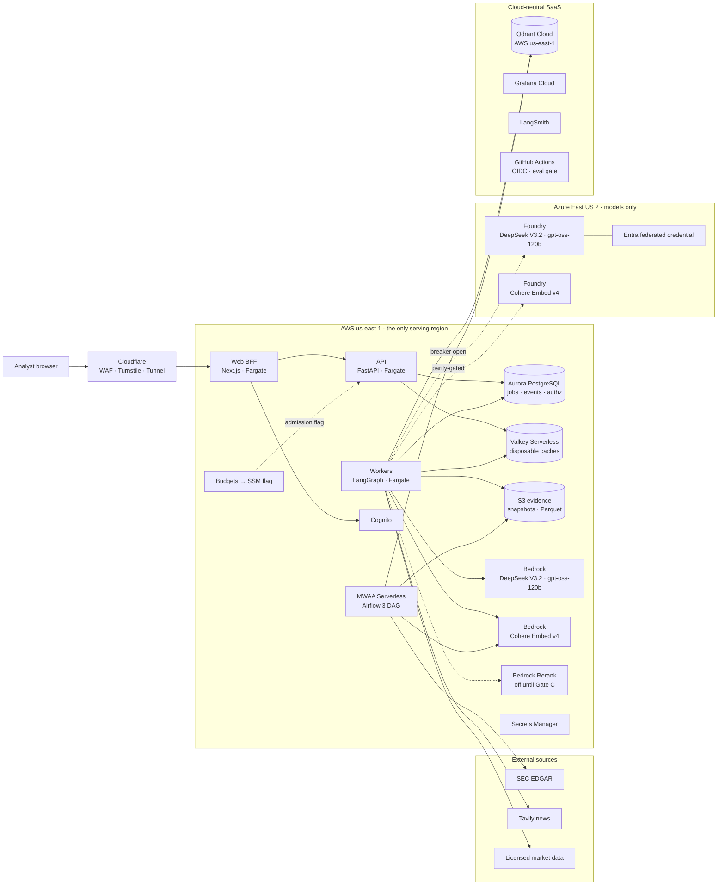
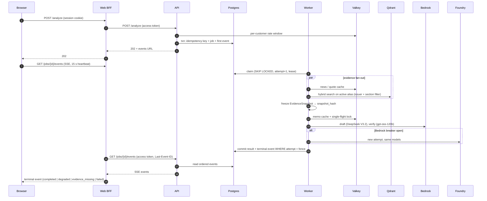
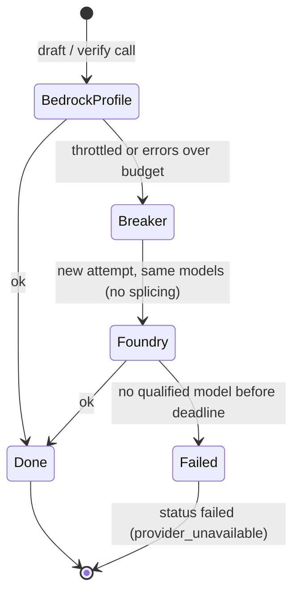
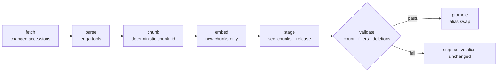

# Cloud Deployment — Accepted Design (S10)

> **Status:** Accepted design, 2026-10-08 ([ADR-0006](adr/ADR-0006-production-cloud-deployment.md)). **Nothing here is deployed.** Cloud resources wait for the S10 entry criteria (§9). Costs are projections from stated assumptions, not quotes or measurements.
>
> **Authority:** this is a design companion (SPEC §0 rank 6, with the diagrams). Where it disagrees with SPEC, an ADR, test-plan or sprint-plan, those govern.

The decisions were made by the owner in the multi-cloud blueprint review on 2026-10-07/08: seventeen decisions (D01–D17), four changed by the owner, one challenge answered, the rest accepted.

## 1. Decision index

| ID | Decision | Outcome | Record |
| --- | --- | --- | --- |
| D01 | Cloud posture | AWS is the only serving cloud; Azure is the model plane (LLM + embedding fallback); region loss is documented, not built | ADR-0006 |
| D02 | Region | `us-east-1` (already configured); Bedrock through US cross-region inference profiles | ADR-0006 |
| D03 | Front door | Cloudflare: DNS, WAF, Turnstile, edge rate rules, Tunnel (demo), status page | ADR-0006 |
| D04 | Runtime | ECS Fargate on Graviton for web BFF, API, workers, FinBERT | ADR-0006 |
| D05 | Identity | Cognito Essentials, server-side session in the BFF, issuer allowlist, customer-scoped authorization, `analyst`/`admin` roles | ADR-0010 |
| D06 | Durable state | Aurora PostgreSQL Serverless v2: jobs, leases + fencing, events, idempotency, quotas, checkpointer | ADR-0013 |
| D07 | Queue graduation | Postgres `SKIP LOCKED` now; outbox → SQS + DLQ on a measured trigger | ADR-0013 |
| D08 | Caching | ElastiCache Serverless for Valkey, disposable only, versioned keys, exact query-embedding cache, single-flight | ADR-0013 |
| D09 | LLM plane | DeepSeek V3.2 draft + gpt-oss-120b judge/verifier on Bedrock; same models on Foundry as fallback | ADR-0009 amendment |
| D10 | Embeddings | Cohere Embed v4, 1024 dims, Bedrock + Foundry fallback behind a parity gate; Gate C bake-off decides adoption | ADR-0011 |
| D11 | Vector store | Qdrant Cloud in `us-east-1`; collection per release, alias promotion | ADR-0003 addendum |
| D12 | Rerank | Bedrock Cohere Rerank 3.5, off until Gate C shows lift | ADR-0011 |
| D13 | Sentiment | FinBERT out of process; scores cached by article hash and model version | ADR-0013 |
| D14 | Evidence storage | S3 versioned + Object Lock on approved releases; in-region backups only; **no cross-region copies** | ADR-0006 |
| D15 | Ingestion | Airflow 3 on MWAA Serverless, ECS task per `dataops` step; EDGAR limiter; licensed market data | ADR-0012 |
| D16 | Secrets, IaC, deploy gate | OIDC everywhere, Secrets Manager, Terraform, eval-gated blue/green deploy, $100 budget with kill switch | ADR-0006 |
| D17 | Observability | OpenTelemetry → Grafana Cloud; LangSmith for LLM traces | ADR-0006 |

Owner changes, for the record: D01 (single serving cloud, Azure for models only), D02 (`us-east-1`), D09 (cheaper models), D14 (no cross-region copies; explain the failure mode instead). D15 was challenged ("why reject Airflow?") and resolved to MWAA Serverless.

## 2. Topology

Not drawn, to keep the view readable: every service exports OpenTelemetry to Grafana Cloud and LLM traces to LangSmith; GitHub Actions deploys to both clouds through OIDC. The [Excalidraw HLD](System-design/production/hld.excalidraw) shows them.

Every cross-cloud arrow is a stateless model request. Nothing that must stay consistent (jobs, idempotency keys, evidence, index releases, users) exists outside `us-east-1`. The bottleneck at every tier above the demo is provider token throughput, so worker concurrency is capped by the token budget, not by CPU.

## 3. Request path

## 4. Degradation ladders

| Dependency | First fallback | Last resort | Terminal status |
| --- | --- | --- | --- |
| Draft / verifier model | Bedrock US inference profile → Foundry, same models | Typed failure | `completed` on fallback, else `failed` |
| Query embedding | Exact cache → Bedrock → Foundry (only after parity passed) | Sparse-only retrieval | `completed`, or `degraded` (`reduced_retrieval`) |
| Valkey | Conservative per-task rate limit; run cold | — | Unchanged; slower and costlier |
| Worker crash | Lease expiry; next attempt resumes from the frozen snapshot | — | One committed result; possible duplicate spend recorded |
| Required filings absent | Other evidence still collected | — | `evidence_missing` |
| Budget exhausted | Admission flag set by Budgets action | — | New jobs 503; running jobs finish |
| `us-east-1` lost | Cloudflare status page | Documented recovery (§6) | Outage |

## 5. Ingestion

Airflow 3 on MWAA Serverless runs this nightly; each box is an ECS task running one `dataops` subcommand (to be built in S10-T05; today `dataops/` exposes only live evidence capture). All tasks share one EDGAR limiter at ≤ 8 requests/second. Vectors and manifests are written to S3 before staging, so any collection can be rebuilt without re-embedding.

## 6. Region-loss failure mode (documented, not built)

The owner chose to explain this failure mode rather than pay for its mitigation (D14).

**What breaks:** everything stateful lives in `us-east-1`. Losing the region takes down the web BFF, API, workers, Cognito (nobody can sign in), Aurora, the evidence bucket and the Qdrant cluster. Bedrock calls originate in the region, so they stop too; Foundry stays up but nothing calls it. Cloudflare serves a static status page.

**What can be lost permanently**, if the region's storage never returns:

- Jobs, results and run records in Aurora.
- Frozen evidence releases in S3. SEC filings can be refetched, but past news results and quotes cannot, so approved quality baselines would no longer be reproducible. This is the most expensive loss for this project, because baselines are its evidence of quality.
- The vector index, which is rebuildable from Parquet only if the Parquet survives.

**Mitigations, cheapest first** (all recorded in ADR-0006, none built):

1. S3 Cross-Region Replication of the evidence bucket to `us-west-2`: about $1–3/month at current size; removes the irreproducible-baseline risk.
2. AWS Backup cross-region copies of Aurora snapshots: RPO up to 24 h.
3. ECR image replication: no rebuild during recovery.
4. Aurora Global Database: RPO about 1 s; a second always-on cluster.
5. Warm standby: the same Terraform applied with `region = "us-west-2"`.

**Recovery with mitigations 1–3 in place:** apply the stack in `us-west-2`, restore the database, create a Qdrant Cloud cluster there and bulk-load vectors from Parquet (no re-embedding), point Cloudflare at the new origin, recreate the Cognito pool (users must re-register or be migrated). Bedrock US profiles keep serving models in the new region.

**Trigger to build them:** a stated availability SLO (≥ 99.95%/month) or a paying user.

## 7. Cost model

Assumptions: draft ≈ 10k input / 2k output tokens on DeepSeek V3.2 ($0.62/$1.85 per million), verifier ≈ 8k / 0.5k on gpt-oss-120b ($0.15/$0.60), 25% repair rate → **≈ $0.014 per uncached memo** (a Claude Sonnet/Haiku pair would be ≈ $0.075). Rerank ≈ $0.008 per memo if Gate C adopts it. Azure failover assumed at 3% of generation spend. Cognito Essentials $0.015/MAU after 10,000 free; MAU = 50% of users.

| Tier | Memos/day | Cache hit | Generation | Rerank (if adopted) | Identity | Infrastructure | **Monthly total** | Per memo |
| --- | ---: | ---: | ---: | ---: | ---: | ---: | ---: | ---: |
| Demo (ADR-0006 cap) | 25 | 5% | $10 | $6 | $0 | $63 | **$73** ($79 if rerank is adopted) | $0.105 |
| 1K users | 100 | 5% | $40 | $23 | $0 | $123 | **$187** | $0.062 |
| 100K users | 10,000 | 20% | $3.4k | $1.9k | $600 | $2.0k | **$8.0k** | $0.027 |
| 1M users | 100,000 | 35% | $27k | $16k | $7.4k | $11k | **$62k** | $0.021 |
| 10M users | 1,000,000 | 45% | $231k | $132k | $75k | $48k | **$493k** | $0.016 |

What the table says:

- Below about 1K users, fixed infrastructure (Fargate tasks, Aurora, the Valkey floor) is the largest cost, not tokens.
- From 100K users, generation dominates and identity becomes the second-largest line at 1M+; the Lite tier or negotiated pricing is the lever there.
- Rerank would add more than half again on top of generation, so it must earn its place in Gate C.
- The cache-hit rates are assumptions to measure, not results.

**Budget controls (demo):** $100/month ceiling; 25 memos/day admission cap; AWS Budgets action at 100% sets the admission flag; Aurora scales to zero; Qdrant free node with a weekly keep-alive; Cloudflare Tunnel instead of an ALB; MWAA Serverless bills only while tasks run.

## 8. Deployment and teardown

1. Tag a release. GitHub Actions authenticates to AWS and Azure through OIDC.
2. Build ARM images and push to ECR.
3. Run `eval-replay` on the frozen evidence release (SPEC §11.2). A regression beyond tolerance stops the release.
4. ECS blue/green deployment, smoke test, traffic shift.

`terraform destroy` removes every resource except the evidence bucket (`prevent_destroy`, Object-Locked approved releases). The Qdrant Cloud cluster and Foundry deployments are destroyed through their providers.

## 9. S10 entry criteria and task outline

Before the first `terraform apply` (ADR-0006): Gate A cleared; S2-T00b and S2-T00d done; S7 local seams built (Postgres RunStore and queue, caches, guardrails, FinBERT out of process); `eval-replay` CI job in place; DeepSeek V3.2 and gpt-oss-120b qualified on Bedrock against frozen evidence, and the Gate C embedding bake-off done if the embedding model changes.

Before the environment is left running: Foundry and embedding parity measured against the first apply's deployments (fallbacks stay off until they pass); two clean `apply → smoke → destroy` rehearsals.

Task outline (detailed in `docs/sprint-plan.md` when S10 opens):

| Task | Scope | Done when |
| --- | --- | --- |
| S10-T01 | Terraform demo tier (network, ECS, Aurora, Valkey, S3, Cognito, Secrets, Budgets, Cloudflare, Qdrant, Foundry) | apply → smoke → destroy twice from a clean checkout |
| S10-T02 | Deploy pipeline with the eval gate | A deliberately regressing release is blocked |
| S10-T03 | Foundry fallback (S7-AZURE-FALLBACK) and model parity | Parity recorded for both models on the frozen eval set |
| S10-T04 | Embedding parity gate and Gate C outcome applied | Parity ≥ 0.999 recorded, or fallback stays off |
| S10-T05 | MWAA Serverless ingestion DAG | Nightly run promotes a validated release; failed validation leaves the alias unchanged |
| S10-T06 | Identity and RBAC (Cognito, BFF session) | test-plan §20 identity cases pass |
| S10-T07 | Observability and budget kill switch | Dashboards live; a simulated budget breach blocks admission |
| S10-T08 | Region-loss runbook (documentation only) | §6 reviewed against the deployed resources |

## 10. Diagrams

| Diagram | Editable source | Renders |
| --- | --- | --- |
| Deployment HLD | [`production/hld.excalidraw`](System-design/production/hld.excalidraw) | [`png`](png/production/hld.png) · [`svg`](svg/production/hld.svg) |
| Critical request flow and failover | [`production/critical-flow.excalidraw`](System-design/production/critical-flow.excalidraw) | [`png`](png/production/critical-flow.png) · [`svg`](svg/production/critical-flow.svg) |
| Contracts (state, cache keys, releases, roles) | [`production/lld.excalidraw`](System-design/production/lld.excalidraw) | [`png`](png/production/lld.png) · [`svg`](svg/production/lld.svg) |
| Failure modes, cost and graduation triggers | [`production/system-design.excalidraw`](System-design/production/system-design.excalidraw) | [`png`](png/production/system-design.png) · [`svg`](svg/production/system-design.svg) |

## 11. Verify before implementation

- Prices: DeepSeek V3.2 and gpt-oss-120b on Foundry; MWAA Serverless per-task rate; Bedrock rerank per 1,000 queries; every infrastructure line above.
- Availability: Qdrant Cloud paid tier in `us-east-1`; `EcsRunTaskOperator` in MWAA Serverless; Cohere Embed v4 at 1024 dims on Foundry; Bedrock batch embedding.
- Identity: Entra accepts the AWS STS outbound identity token (spike).
- Licensing: market-data redistribution terms for quotes shown in memos.

Sources for prices and service facts are listed in the blueprint review and the ADRs; all were current as of 2026-10-08 and must be re-checked.
