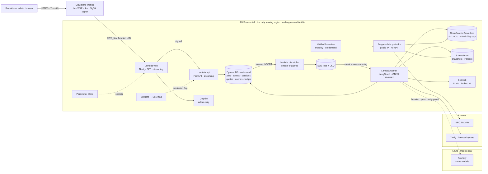
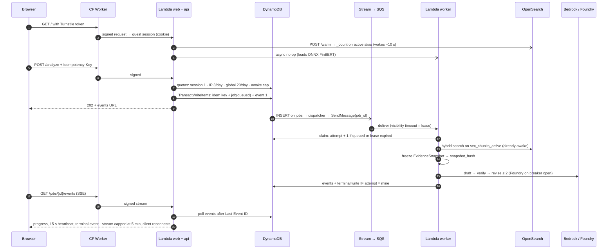
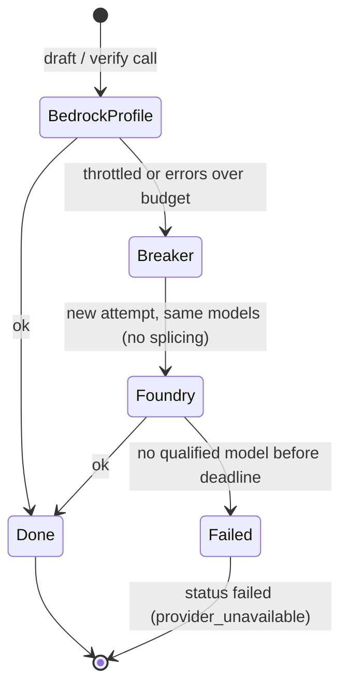
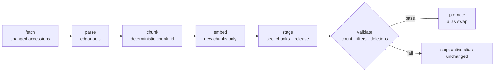

# Cloud Deployment — Accepted Design (S10)

> **Status:** Accepted design. Decisions of 2026-10-08 ([ADR-0006](adr/ADR-0006-production-cloud-deployment.md)), vector store revised 2026-10-11 ([ADR-0014](adr/ADR-0014-opensearch-serverless-vector-store.md)), and **runtime and state moved to scale-to-zero services on 2026-10-11** ([ADR-0015](adr/ADR-0015-scale-to-zero-serverless-deployment.md)). **Nothing here is deployed.** Cloud resources wait for the S10 entry criteria (§9). Costs are projections from stated assumptions, not quotes or measurements.
>
> **Authority:** this is a design companion (SPEC §0 rank 6, with the diagrams). Where it disagrees with SPEC, an ADR, test-plan or sprint-plan, those govern.
>
> **Two tiers.** This document describes the **demo tier** that S10 deploys. The always-on design accepted on 2026-10-08 (ECS Fargate, Aurora PostgreSQL, Valkey) is the **production scale tier**, written up for interviews in [`production-scale-architecture.md`](production-scale-architecture.md) with the trigger that moves each component.

**Usage the demo tier is built for (owner, 2026-10-11):** a portfolio deployment used only when a recruiter tries it, typically one query per visit, with days of no traffic in between. No service needs to run every day, so every component is pay-per-use or free while idle.

## 1. Decision index

| ID | Decision | Outcome | Record |
| --- | --- | --- | --- |
| D01 | Cloud posture | AWS is the only serving cloud; Azure is the model plane (LLM + embedding fallback); region loss is documented, not built | ADR-0006 |
| D02 | Region | `us-east-1` (already configured); Bedrock through US cross-region inference profiles | ADR-0006 |
| D03 | Front door | Cloudflare: DNS, free WAF rules, Turnstile, status page. **Revised:** a Cloudflare Worker signs requests (SigV4) to an IAM-protected Lambda function URL; no Tunnel | ADR-0006, ADR-0015 |
| D04 | Runtime | **Revised:** three arm64 Lambda functions (web BFF, API, worker) with response streaming; Fargate only for ingestion tasks. ECS Fargate services are the scale tier | ADR-0015 |
| D05 | Identity | Cognito Essentials for the admin; **revised:** Turnstile-gated guest mode for recruiters; issuer allowlist, customer-scoped authorization | ADR-0010 (+ amendment) |
| D06 | Durable state | **Revised:** DynamoDB on-demand: jobs, fenced attempts, events, idempotency, sessions, quotas, LangGraph checkpoints. Aurora is the scale tier | ADR-0013 (+ amendment), ADR-0015 |
| D07 | Queue | **Revised:** SQS + DLQ from the start, fed by DynamoDB Streams (outbox without an outbox table). The Postgres `SKIP LOCKED` queue is the scale tier | ADR-0013 (+ amendment), ADR-0015 |
| D08 | Caching | **Revised:** the same versioned keys as DynamoDB items with TTL; exact query-embedding cache; single-flight by conditional put. Valkey is the scale tier | ADR-0013 (+ amendment), ADR-0015 |
| D09 | LLM plane | DeepSeek V3.2 draft + gpt-oss-120b judge/verifier on Bedrock; same models on Foundry as fallback | ADR-0009 amendment |
| D10 | Embeddings | Cohere Embed v4, 1024 dims, Bedrock + Foundry fallback behind a parity gate; Gate C bake-off decides adoption | ADR-0011 |
| D11 | Vector store | Amazon OpenSearch Serverless (next generation, scales to zero) in `us-east-1`; index per release, alias promotion; 45 awake minutes per day as an abuse guard; Qdrant Cloud is the fallback if the paired comparison fails | ADR-0014 (+ amendment) |
| D12 | Rerank | Bedrock Cohere Rerank 3.5, off until Gate C shows lift | ADR-0011 |
| D13 | Sentiment | **Revised:** FinBERT exported to ONNX inside the worker Lambda; scores cached by article hash and model version | ADR-0015 |
| D14 | Evidence storage | S3 versioned + Object Lock on approved releases; in-region backups only; **no cross-region copies** | ADR-0006 |
| D15 | Ingestion | Airflow 3 on MWAA Serverless, ECS task per `dataops` step; **revised:** monthly plus admin trigger; EDGAR limiter; licensed market data | ADR-0012 (+ amendment) |
| D16 | Secrets, IaC, deploy gate | OIDC everywhere, Terraform, eval-gated deploy. **Revised:** Parameter Store SecureString instead of Secrets Manager; Lambda alias shift; $100 kill switch with $10 and $25 alerts | ADR-0006, ADR-0015 |
| D17 | Observability | OpenTelemetry → Grafana Cloud; LangSmith for LLM traces | ADR-0006 |
| D18 | Network | No VPC for Lambda (function URL streaming does not work inside one), so no NAT gateway; ingestion tasks use a public IP | ADR-0015 |
| D19 | Cold start | Landing-page warm-up of the worker and the search collection; SnapStart and provisioned concurrency rejected (both bill while idle) | ADR-0015 |

Owner changes, for the record: D01, D02, D09 and D14 on 2026-10-08; D15 challenged and resolved to MWAA Serverless; D11 on 2026-10-11 (OpenSearch Serverless; Azure AI Search as documented mitigation only); D03–D08, D13, D15, D16 revised and D18–D19 added on 2026-10-11 for the recruiter-only usage pattern, with OpenSearch Serverless kept and guest access added.

## 2. Topology

Not drawn, to keep the view readable: every function exports OpenTelemetry directly to Grafana Cloud (flushed at the end of each invocation) and LLM traces to LangSmith; GitHub Actions deploys through OIDC. The [serverless HLD](System-design/serverless/hld.excalidraw) shows them.

Every cross-cloud arrow is a stateless model request. Nothing that must stay consistent exists outside `us-east-1`. Reserved concurrency (web 10, api 10, worker 3 with the queue limited to 2) is the hard ceiling on spend rate; excess jobs wait in SQS.

## 3. Request path (first query after days idle)

## 4. Degradation ladders

| Dependency | First fallback | Last resort | Terminal status |
| --- | --- | --- | --- |
| Draft / verifier model | Bedrock US inference profile → Foundry, same models | Typed failure | `completed` on fallback, else `failed` |
| Query embedding | Exact cache → Bedrock → Foundry (only after parity passed) | Keyword-only (BM25) retrieval | `completed`, or `degraded` (`reduced_retrieval`) |
| Search collection asleep | Warm-up on the landing page; otherwise wakes on the first query (about 10 s) | — | Unchanged; slower first job |
| Daily awake cap reached | Exact memo-cache hits and example memos still served | New retrieval jobs 429 until the next UTC day (`search_awake_cap`) | Running jobs finish |
| Guest quota reached | Example memos still replay | 429 with `Retry-After` | — |
| Cache read error | Run cold | — | Unchanged; slower and costlier |
| Worker crash or timeout | Retry inside the invocation from the last checkpoint; an unrecoverable error makes the message visible again after 10 s; a hard timeout redelivers after 6 min; each retry runs `attempt + 1` | Third receive → DLQ handler writes `failed` and bumps `attempt` | One committed result |
| Job past its deadline | Lazy expiry on the next read (no sweeper) | — | `failed` (`deadline_exceeded`) |
| Required filings absent | Other evidence still collected | — | `evidence_missing` |
| Budget exhausted | Admission flag set by the Budgets action | — | New jobs 503; running jobs finish |
| `us-east-1` lost | Cloudflare status page | Documented recovery (§6) | Outage |

## 5. Ingestion

Airflow 3 on MWAA Serverless runs this **monthly, or when the admin triggers it** (`POST /ingest`); each box is an `EcsRunTaskOperator` task (verified supported on 2026-10-11) running one `dataops` subcommand, to be built in S10-T05 (today `dataops/` exposes only live evidence capture). Tasks run in public subnets of the default VPC with a public IP and no inbound rules, so no NAT gateway exists. All tasks share one EDGAR limiter at ≤ 8 requests/second. Vectors and manifests are written to S3 before staging, so any index can be rebuilt without re-embedding. `validate` polls `_count` until it equals the manifest before `promote` swaps the alias (ADR-0014). A run keeps OpenSearch awake for about 20 minutes; at most two runs a month, outside the query awake cap.

## 6. Region-loss failure mode (documented, not built)

The owner chose to explain this failure mode rather than pay for its mitigation (D14).

**What breaks:** everything stateful lives in `us-east-1`. Losing the region takes down the Lambda functions, DynamoDB, SQS, Cognito (the admin cannot sign in; guests need no account but have nothing to call), the evidence bucket and the OpenSearch collection. Bedrock calls originate in the region, so they stop too; Foundry stays up but nothing calls it. Cloudflare serves a static status page.

**What can be lost permanently**, if the region's storage never returns:

- Jobs, results and run records in DynamoDB.
- Frozen evidence releases in S3. SEC filings can be refetched, but past news results and quotes cannot, so approved quality baselines would no longer be reproducible. This is the most expensive loss for this project, because baselines are its evidence of quality.
- The vector index, which is rebuildable from Parquet only if the Parquet survives.

**Mitigations, cheapest first** (recorded in ADR-0006, none built):

1. S3 Cross-Region Replication of the evidence bucket to `us-west-2`: about $1–3/month at current size; removes the irreproducible-baseline risk.
2. AWS Backup cross-region copies of DynamoDB backups: RPO up to 24 h.
3. ECR image replication: no rebuild during recovery.
4. DynamoDB global tables: RPO about 1 s, billed per replicated write (near zero at demo traffic).
5. Warm standby: the same Terraform applied with `region = "us-west-2"`. With scale-to-zero services a standby costs almost nothing while idle, so this is cheaper here than it would be in the scale tier.
6. An Azure-side index on Azure AI Search, only once its serverless tier is generally available with alias support (today: preview, no SLA, no aliases, 1 GB per index). It is a different search engine, so it would need its own retrieval parity gate (owner decision 2026-10-11, ADR-0014).

**Recovery with mitigations 1–3 in place:** apply the stack in `us-west-2`, restore the tables, create an OpenSearch Serverless collection there and bulk-load vectors from Parquet (no re-embedding), point the Cloudflare Worker at the new function URL, recreate the Cognito pool and the admin user. Bedrock US profiles keep serving models in the new region.

**Trigger to build them:** a stated availability SLO (≥ 99.95%/month) or a paying user.

## 7. Cost model

Assumptions: 20 recruiter sessions a month, each one live memo plus a warm-up; one ingestion run a month; corpus and Parquet about 3 GB. Draft ≈ 10k input / 2k output tokens on DeepSeek V3.2 ($0.62/$1.85 per million), verifier ≈ 8k / 0.5k on gpt-oss-120b ($0.15/$0.60), 25% repair rate → **≈ $0.014 per uncached memo**. OpenSearch Serverless (next generation) at about $0.334 per OCU-hour (a third-party figure; verify), 2 OCUs while awake, about 12 awake minutes per session including the 10-minute idle tail. Lambda arm64 at $0.0000133 per GB-second.

| Line | Idle month | Per recruiter session | Notes |
| --- | ---: | ---: | --- |
| OpenSearch compute | $0 | $0.13 | Idle tail dominates; ingestion run ≈ $0.22 |
| OpenSearch storage | ≈ $0.05 | — | Price to verify |
| Generation (Bedrock) | $0 | $0.014 | Query embedding < $0.001 |
| Lambda (web, api, worker) | $0 | ≈ $0.008 | ≈ 600 GB-s; inside the monthly free tier at this volume |
| DynamoDB, SQS, stream dispatch | < $0.05 | < $0.001 | On-demand; stream reads by Lambda triggers should be free (to verify) |
| S3, ECR, CloudWatch Logs (7-day retention) | ≈ $0.35 | — | Storage only |
| MWAA Serverless + Fargate ingestion | $0 | — | ≈ $0.50 per run (MWAA rate to verify) |
| Cognito, Cloudflare, Parameter Store, Grafana Cloud, LangSmith, Foundry | $0 | $0 | Free tiers or pay-per-call fallbacks |
| **Total** | **≈ $0.45** | **≈ $0.15** | **≈ $4/month** at 20 sessions + one ingestion run |

**Worst case under the guards:** 20 live guest jobs a day for a month: search capped at 45 min/day ≈ $15, generation ≈ $8.40, Lambda ≈ $5, plus the floor and two ingestion runs ≈ **$30/month**. The $100 kill switch is a backstop that should never trip; alerts fire at $10 and $25.

**What this replaced:** the always-on design projected about $95/month at 25 memos/day, nearly all of it idle capacity (Fargate tasks, the Valkey floor, search awake time), and that projection omitted a NAT gateway (≈ $33/month) for private-subnet egress.

**Where the demo tier stops being the right design:** at about 1K users (100 memos/day) the demo-tier services, with the guest quotas and the awake cap lifted, still cost less (≈ $280/month with rerank: generation $40, rerank $23, search ≈ $200 at 10 awake hours a day, Lambda and storage ≈ $16) than the always-on design (≈ $387). From about 1k memos a day (twice the ≈ 540/day break-even) the worker's wall-clock billing while it waits on model tokens overtakes an always-on asynchronous worker fleet. That is the first graduation trigger. The 100K, 1M and 10M tiers ($8.7k, $63k and $500k/month) are costed on the production scale tier in [`production-scale-architecture.md`](production-scale-architecture.md) §8.

**Budget controls (demo):** guest quotas (1 live job per session, 3 per IP per day, 20 a day overall); reserved concurrency; the 45-minute daily awake cap (ledger in DynamoDB, reconciled daily with CloudWatch); AWS Budgets action at 100% of $100 sets the admission flag; no VPC, so no NAT; Parameter Store and AWS-managed keys instead of per-month secrets and keys.

## 8. Deployment and teardown

1. Tag a release. GitHub Actions authenticates to AWS, Azure and Cloudflare through OIDC or scoped tokens.
2. Build arm64 images and push to ECR.
3. Run `eval-replay` on the frozen evidence release (SPEC §11.2). A regression beyond tolerance stops the release.
4. Publish new versions of `web`, `api` and `worker`; smoke-test them on the `candidate` alias (guest session, one example-memo replay, one live job against stand-in providers); move the `live` alias, which the function URLs point at. Rollback is one alias update.
5. A separate scheduled GitHub Actions job rotates the Cloudflare Worker's invoke-only signing key every 30 days.

`terraform destroy` removes every resource except the evidence bucket (`prevent_destroy`, Object-Locked approved releases). The OpenSearch collection group and the Foundry deployments are destroyed with the rest of the stack.

## 9. S10 entry criteria and task outline

Before the first `terraform apply` (ADR-0006): Gate A cleared; S2-T00b and S2-T00d done; S7 local seams built (DynamoDB `RunStore` and SQS `JobQueue` against DynamoDB Local and ElasticMQ, caches, guardrails, guest and admin access, ONNX FinBERT with recorded label parity); `eval-replay` CI job in place; DeepSeek V3.2 and gpt-oss-120b qualified on Bedrock against frozen evidence, and the Gate C embedding bake-off done if the embedding model changes.

Before the environment is left running: Foundry and embedding parity measured against the first apply's deployments (fallbacks stay off until they pass); retrieval parity of OpenSearch Serverless against the Qdrant baseline (ADR-0014; on failure the deployment uses Qdrant Cloud); two clean `apply → smoke → destroy` rehearsals, each recording cold-start latency with and without the warm-up.

Task outline (detailed in `docs/sprint-plan.md` when S10 opens):

| Task | Scope | Done when |
| --- | --- | --- |
| S10-T01 | Terraform demo tier (Lambda functions and aliases, function URLs, DynamoDB tables and stream, SQS + DLQ, S3, Cognito, Parameter Store, Budgets, Cloudflare Worker, OpenSearch Serverless, Foundry) | apply → smoke → destroy twice from a clean checkout |
| S10-T02 | Deploy pipeline with the eval gate and alias shift | A deliberately regressing release is blocked; rollback by alias update is rehearsed |
| S10-T03 | Foundry fallback (S7-AZURE-FALLBACK) and model parity | Parity recorded for both models on the frozen eval set |
| S10-T04 | Embedding parity gate and Gate C outcome applied | Parity ≥ 0.999 recorded, or fallback stays off |
| S10-T05 | MWAA Serverless ingestion DAG, monthly + admin trigger | A run promotes a validated release; failed validation leaves the alias unchanged |
| S10-T06 | Identity: guest mode, Cognito admin, BFF sessions | test-plan §20 identity and guest-quota cases pass |
| S10-T07 | Observability and budget kill switch | Dashboards live; a simulated budget breach blocks admission |
| S10-T08 | Region-loss runbook (documentation only) | §6 reviewed against the deployed resources |
| S10-T09 | OpenSearch store, paired comparison and awake cap (ADR-0014) | Contract suite passes; paired result recorded; a capped day refuses a cold wake but serves a cache hit |
| S10-T10 | Edge and cold start (ADR-0015) | Unsigned requests to the function URL are refused; Worker CPU per request < 10 ms; first-query latency with and without the warm-up recorded |

## 10. Diagrams

| Diagram | Editable source | Renders |
| --- | --- | --- |
| Demo tier HLD (deployed design) | [`serverless/hld.excalidraw`](System-design/serverless/hld.excalidraw) | [`png`](png/serverless/hld.png) · [`svg`](svg/serverless/hld.svg) |
| Demo tier cold-start request flow | [`serverless/critical-flow.excalidraw`](System-design/serverless/critical-flow.excalidraw) | [`png`](png/serverless/critical-flow.png) · [`svg`](svg/serverless/critical-flow.svg) |
| Demo tier contracts (tables, conditional writes, guest quotas) | [`serverless/lld.excalidraw`](System-design/serverless/lld.excalidraw) | [`png`](png/serverless/lld.png) · [`svg`](svg/serverless/lld.svg) |
| Production scale tier (interview design) | [`production/*.excalidraw`](System-design/production/) | [`png/production/`](png/production/) · [`svg/production/`](svg/production/) |

## 11. Verify before implementation

- Prices: DeepSeek V3.2 and gpt-oss-120b on Foundry; MWAA Serverless per-run rate; Bedrock rerank per 1,000 queries; OpenSearch next-generation OCU and storage prices; every infrastructure line above.
- ADR-0015 spikes: function URL with `AWS_IAM` and response streaming, signed by the Worker; Worker CPU time; stream-triggered dispatch to SQS; ONNX FinBERT parity and initialization time; cold-start latency.
- OpenSearch Serverless (ADR-0014): idle timeout and cold start on the pinned configuration; Terraform `aws` provider support for `NEXTGEN` collection groups (else `awscc`); hybrid search pipeline and metadata filters on a next-generation `VECTORSEARCH` collection.
- Availability: Cohere Embed v4 at 1024 dims on Foundry; Bedrock batch embedding. (`EcsRunTaskOperator` in MWAA Serverless: verified 2026-10-11.)
- Identity: Entra accepts the AWS STS outbound identity token (spike).
- Licensing: market-data redistribution terms for quotes shown in memos. A paid plan would be the only fixed monthly line in this design.

Sources for prices and service facts are listed in the ADRs; all were current as of 2026-10-08 to 2026-10-11 and must be re-checked.
