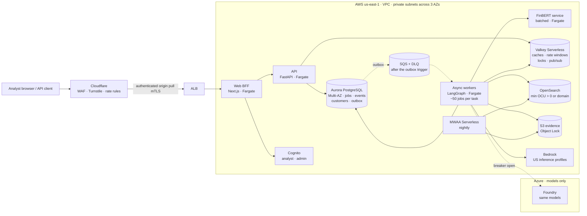
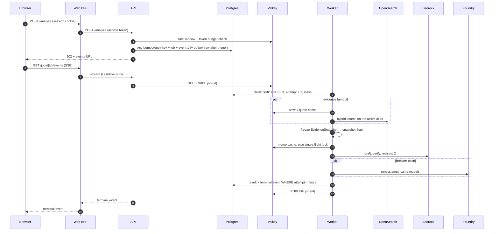

# Production Scale Tier — How This System Becomes an Industry-Grade Service

> **Status:** Interview design, **not built**. What S10 deploys is the scale-to-zero demo tier (designed, not yet deployed; [ADR-0015](adr/ADR-0015-scale-to-zero-serverless-deployment.md), [`cloud-deployment.md`](cloud-deployment.md)). This document is the always-on design accepted on 2026-10-08 ([ADR-0006](adr/ADR-0006-production-cloud-deployment.md), [ADR-0010](adr/ADR-0010-identity-and-authorization.md) to [ADR-0014](adr/ADR-0014-opensearch-serverless-vector-store.md)), kept as the target for steady traffic, with the measured trigger that moves each component and the migration path from the demo tier.
>
> **Authority:** design companion (SPEC §0 rank 6). Scale numbers are projections from stated formulas, not measured capacity. Where this document disagrees with SPEC or an ADR, those govern.
>
> **Interview question it answers:** *"How would you productionize this? How would you make it an industry-grade, scalable application?"*

## 0. The 60-second answer

Worded as it will be said once S10 has deployed the demo tier.

"The deployed demo is deliberately scale-to-zero: Lambda, DynamoDB, SQS and OpenSearch Serverless, about $4 a month, because recruiters use it once in a while. Every correctness contract is already production-grade: idempotent acceptance, fenced attempts, replayable events, versioned cache keys, release-pinned indexes, eval-gated deploys. What changes at scale is cost structure and latency, not correctness. Each component has a measured trigger. The worker moves first: Lambda bills wall-clock time while it waits on model tokens, so past roughly a thousand memos a day an async worker fleet on ECS Fargate is cheaper. Then Aurora PostgreSQL becomes the system of record for customers, entitlements and audit, with a `SKIP LOCKED` queue and a transactional outbox to SQS. Valkey takes caches, rate limits and event fan-out. The web tier moves behind an ALB. Every move is an adapter swap behind an existing protocol, shadowed and compared before cut-over. The real bottleneck at 1M+ users is model token throughput, so admission control and caching are designed around the token budget, not CPU."

## 1. Decision

- **Same contracts, different services.** The scale tier keeps every contract of the demo tier (ADR-0013 acceptance, fencing, event replay, cache keys; ADR-0014 index releases; ADR-0010 issuer allowlist) and changes only the services that realize them.
- **Compute:** ECS Fargate on Graviton. Async LangGraph workers each multiplex many I/O-bound jobs; FinBERT becomes its own batched CPU service; web BFF and API run as always-warm services behind an ALB. No Kubernetes.
- **State:** Aurora PostgreSQL (Multi-AZ) is the system of record: jobs, events, idempotency, customers, entitlements, quotas, run records. The job row is the queue (`FOR UPDATE SKIP LOCKED`) until claim latency or rate crosses its trigger; then a transactional outbox feeds SQS with a dead-letter queue.
- **Ephemeral state:** ElastiCache Serverless for Valkey for caches, rate-limit windows, single-flight locks and event fan-out. Never durable; losing it loses no job.
- **Search:** OpenSearch Serverless with a non-zero minimum, then a managed domain above about 4 OCUs around the clock. Index per release with alias promotion, unchanged.
- **Capacity is a token budget.** Admission control, caching and worker concurrency are sized from provider tokens per minute, because model throughput is the first bottleneck at 1M+ users.

## 2. What changes from the deployed demo tier, and when

Each row is one decision. The demo tier is right until its trigger is measured; the scale tier is the move.

| Concern | Demo tier (S10, ADR-0015) | Scale tier (this document) | Trigger to move | Why the scale tier is better there |
| --- | --- | --- | --- | --- |
| Worker runtime | Lambda, 3 GB, one job per environment | ECS Fargate async workers, ~50 jobs per task | Lambda worker spend > 2× an equivalent Fargate fleet (≈ 1k memos/day, §8.1), or any job class > 15 min | Lambda bills wall-clock while waiting on tokens; an asyncio worker shares one vCPU across dozens of waiting jobs |
| Web BFF and API | Lambda behind a Cloudflare Worker (SigV4) | Fargate services behind an ALB; Cloudflare with authenticated origin pulls (mTLS) | Sustained traffic near the Workers free limits (100k requests/day), or a cold-start latency SLO | Always warm, pooled connections to Postgres and Valkey, no per-request signing |
| Job store | DynamoDB conditional writes | Aurora PostgreSQL, Multi-AZ | Relational queries in the product (entitlements, billing, audit joins to eval lineage) or transactions above DynamoDB's 100-item limit | SQL joins, row-level security per customer, and the queue in the same transaction as the job |
| Queue | Streams → dispatcher → SQS | Postgres `SKIP LOCKED`; transactional outbox → SQS + DLQ | Outbox when p95 claim > 200 ms or > 500 claims/s (ADR-0013 D07) | No extra system until claim contention is measured; the outbox keeps accept and enqueue atomic |
| Caches, rate limits | DynamoDB items with TTL | ElastiCache Serverless for Valkey | Cache reads where on-demand read cost exceeds Valkey, or a sub-millisecond rate-limit budget | Sub-ms reads, atomic sliding windows, `SET NX PX` locks, pub/sub |
| Event stream | API polls `job_events` every 500 ms | Valkey pub/sub fan-out; Postgres `job_events` for replay | > ~1,000 concurrent streams | Polling cost grows with watchers; pub/sub grows with events |
| Identity | Guest mode + Cognito admin | Cognito self-sign-up `analyst`, per-customer quotas and hashed API keys; Lite tier or negotiated price at large MAU | Named users or a paid plan | Accountable identities and per-customer limits |
| Search | Scale to zero, 45 min/day cap | Minimum OCUs > 0, cap removed; managed domain above ~4 OCUs steady | Cap reached 3+ days a week, or a first-query latency SLO | No 10 s resume on the request path |
| Sentiment | ONNX FinBERT in the worker | Batched FinBERT CPU service | Workers on Fargate (async workers must not block on CPU) | Batching, independent scaling |
| Ingestion | Monthly + admin trigger | Nightly, per-issuer backfill fan-out; Step Functions if fan-out outgrows the DAG | Issuer universe beyond the fixture set, or a filing-freshness SLO < 24 h | Freshness |
| Network, secrets, keys | No VPC; Parameter Store; AWS-managed keys | VPC with private subnets, gateway and interface endpoints, NAT with egress allowlist; Secrets Manager with rotation; customer-managed keys | Aurora or Valkey introduced (both need a VPC), or a compliance requirement | Private data plane, rotation, key-level audit |
| Deploy | Lambda alias shift | ECS blue/green with canary analysis on SLO burn, automatic rollback | Fargate services exist | Gradual exposure measured against SLOs |
| Region | One region, documented failure mode | S3 CRR → cross-region backups → Aurora Global Database → warm standby | Stated SLO ≥ 99.95%/month, or a paying customer | RPO/RTO become promises |
| Models | Bedrock on-demand, same-model Foundry fallback | Quota increases, multiple inference profiles, Foundry spillover; provisioned throughput or self-hosted open weights | 10M tier with a measured business case | Guaranteed token throughput |

## 3. Assumptions and requirements

- **Workload:** a memo request runs 30–90 s, almost entirely waiting on model calls; ≈ 25.6k tokens per uncached memo (draft 10k in / 2k out, verifier 8k in / 0.5k out, 25% repair rate).
- **Traffic ladder** (memos per user per day = 0.1): 100K users → 10k memos/day; 1M → 100k; 10M → 1M. Peak = 10× average (earnings-day bursts).
- **Cache-hit assumptions** to measure, not results: 20% (100K), 35% (1M), 45% (10M).
- **Non-functional targets** (proposed SLOs, §7.3). Correctness invariants are not traded for latency: no `completed` memo without passing verification and output policy.
- **Single active region** until the region trigger fires (ADR-0006 D14 stands).

## 4. HLD



Design notes: the API never calls a model; it only accepts, authorizes and streams. Workers are the only component that talks to providers, so the token budget is enforced in one place. Valkey sits beside Postgres, never in front of it for durable data. Egress to SEC, Tavily, the market-data vendor and Foundry leaves through NAT with an allowlist; S3 uses a gateway endpoint, and Bedrock, SQS, ECR, Secrets Manager, CloudWatch and OpenSearch Serverless use interface endpoints, so model and search traffic never crosses NAT. Cognito's JWKS is fetched rarely and cached.

## 5. Critical flow



The ordering that matters: the terminal event is published only after the fenced commit, so a subscriber never sees a result that a stale attempt could overwrite. A client that missed the publish replays from Postgres with `Last-Event-ID`.

## 6. LLD

### 6.1 Durable state (Aurora PostgreSQL)

```sql
CREATE TABLE jobs (
  id            uuid PRIMARY KEY,
  customer_id   uuid NOT NULL REFERENCES customers(id),
  request_hash  bytea NOT NULL,
  state         job_state NOT NULL DEFAULT 'queued',  -- queued|running|completed|degraded|evidence_missing|failed
  priority      smallint NOT NULL DEFAULT 0,
  attempt       integer NOT NULL DEFAULT 0,            -- fencing token
  lease_until   timestamptz,
  deadline      timestamptz NOT NULL,
  snapshot_hash text,
  result_ref    text,
  created_at    timestamptz NOT NULL DEFAULT now()
);
CREATE INDEX jobs_ready ON jobs (priority DESC, created_at) WHERE state = 'queued';

CREATE TABLE job_events (job_id uuid, seq integer, type text, payload jsonb, at timestamptz,
                         PRIMARY KEY (job_id, seq));
CREATE TABLE idempotency_keys (customer_id uuid, key text, request_hash bytea, job_id uuid,
                               PRIMARY KEY (customer_id, key));
CREATE TABLE outbox (id bigserial PRIMARY KEY, job_id uuid NOT NULL, dispatched_at timestamptz);
ALTER TABLE jobs ENABLE ROW LEVEL SECURITY;   -- customer_id = current_setting('app.customer_id')
```

Claim and fenced commit:

```sql
-- claim: one ready job, no waiting on rows other workers hold
UPDATE jobs SET state = 'running', attempt = attempt + 1, lease_until = now() + interval '60 s'
 WHERE id = (SELECT id FROM jobs
              WHERE (state = 'queued' OR (state = 'running' AND lease_until < now()))
                AND attempt < 3 AND deadline > now()
              ORDER BY priority DESC, created_at
              FOR UPDATE SKIP LOCKED LIMIT 1)
RETURNING id, attempt;

-- exhausted or late: fail it, bumping attempt so a late worker is fenced out
UPDATE jobs SET state = 'failed', attempt = attempt + 1
 WHERE (state = 'queued' OR (state = 'running' AND lease_until < now()))
   AND (attempt >= 3 OR deadline <= now());

-- heartbeat every 15 s; commit only if this attempt still owns the job
UPDATE jobs SET state = $state, result_ref = $ref
 WHERE id = $id AND state = 'running' AND attempt = $fence;  -- 0 rows ⇒ stale
```

Outbox dispatch, once the trigger fires: a relay claims undispatched rows with `SKIP LOCKED`, sends to SQS, then sets `dispatched_at`. Delivery is at-least-once; the fenced claim makes duplicates harmless.

### 6.2 Job state machine

```mermaid
stateDiagram-v2
  [*] --> queued: accept txn
  queued --> running: claim (attempt + 1, lease)
  running --> running: lease expired, re-claimed with attempt + 1 (attempt < 3)
  queued --> failed: deadline passed before a claim
  running --> completed: verified + complete + policy
  running --> degraded: verify failed after repair, or BM25-only
  running --> evidence_missing: required evidence absent
  running --> failed: provider, policy or internal; 3 attempts or deadline exhausted
  completed --> [*]
  degraded --> [*]
  evidence_missing --> [*]
  failed --> [*]
```



Terminal precedence when several apply: `failed` › `evidence_missing` › `degraded` › `completed`. Every terminal write carries the fence.

### 6.3 Ephemeral state (Valkey)

| Key | Purpose | Lifetime |
| --- | --- | --- |
| `ev:{source}:{issuer_cik}:{params_hash}` | Evidence cache | market 60 s, news 15 min, SEC until a new accession |
| `qe:{embedding_fp}:{sha256(normalized_query)}` | Exact query-embedding cache | release lifetime |
| `rr:{index_release}:{retrieval_cfg_fp}:{query_hash}:{filter_hash}` | Retrieval results | release lifetime |
| `memo:{snapshot_hash}:{prompt_v}:{model_fp}:{verifier_policy_fp}` | Memo artifact reference | snapshot validity |
| `lock:memo:{same suffix}` | Single-flight (`SET NX PX`) | generation deadline |
| `rl:{customer_id}:{window}` | Sliding-window rate limit | seconds |
| `tok:{provider}:{minute}` | Global token budget counter | 2 minutes |
| channel `job:{id}` | Event fan-out | none (replay comes from Postgres) |

If Valkey is lost, jobs still complete: caches miss, rate limits fall back to a conservative per-task limit, streams fall back to polling Postgres, and the token budget falls back to a static per-worker concurrency cap.

### 6.4 Admission and autoscaling

- **Admission** (API): authenticated → per-customer rate window → per-customer daily quota (Postgres) → global token budget: if `tok:` this minute exceeds 80% of the provider quota, return 429 with `Retry-After`. Queue backpressure is a decision at admission, not a growing backlog.
- **Worker autoscaling:** target tracking on a published metric, `ready_jobs / (tasks × 50)`, and on oldest-ready-job age; the maximum task count is derived from the token quota, because adding workers beyond it only grows the queue. Scheduled pre-scaling on earnings days.
- **Per-job deadline** of 10 minutes and a cost cap; both end the job with a typed `failed` rather than running indefinitely.

## 7. Scalability and reliability

### 7.1 Capacity model

| Tier | Memos/day | Peak memos/s | Concurrent jobs at peak (Little's law, 60 s) | Uncached tokens/min at peak | Worker tasks at peak | Postgres writes/s at peak (~27 per job) | Search |
| --- | ---: | ---: | ---: | ---: | ---: | ---: | --- |
| 100K users | 10,000 | 1.2 | 70 | 1.4M | 2 (high-availability minimum) | ~30 | 4 OCU |
| 1M users | 100,000 | 11.6 | 700 | 11.6M | 14 | ~310 | 16 OCU |
| 10M users | 1,000,000 | 116 | 7,000 | 98M | 140 | ~3,100 | 64 OCU or a domain |

Tokens per minute = peak memos/s × 60 × 25.6k × (1 − cache hit). The writes per job count acceptance (3), claim (1), heartbeats (~6), events (~15) and commit (2).

### 7.2 Bottlenecks, in the order they appear

1. **Provider token throughput.** At 1M users, peak demand is ~12M tokens/minute across two models; at 10M, ~100M. Default on-demand quotas are far below that. Mechanisms: quota increases across US inference profiles, Foundry spillover for the same models (already qualified by parity), caching (memo, single-flight on snapshot), the repair cap, and admission against the token budget. At 10M, provisioned throughput or self-hosted open weights (vLLM on GPU) are priced against on-demand.
2. **Search OCUs** for hybrid queries at ~116/s: measured on the frozen fixture before the tier is promised; move to a managed domain when steady load exceeds ~4 OCUs around the clock.
3. **Event streams:** 7,000 concurrent SSE connections at 10M peak; pub/sub fan-out keeps Postgres reads proportional to reconnects, not watchers.
4. **Postgres claims:** ~116 claims/s at 10M peak, under the 500/s outbox trigger; writes (~3k/s) fit a single Aurora writer, with partitioning of `job_events` by month for retention.
5. **Identity cost** rather than identity throughput: Cognito Essentials grows to $7.4k at 1M users and $75k at 10M, about 12–15% of the bill (§8).

### 7.3 Proposed SLOs

| SLO | Target | Why this one |
| --- | --- | --- |
| Acceptance availability (`POST /analyze` returns 202 or a typed 4xx/429/503) | 99.9% monthly | The user-facing promise is "your request is durably accepted" |
| Acceptance latency | p95 < 300 ms | No model on this path |
| Verified completion, uncached | p95 < 90 s | Dominated by model latency; tracked per model |
| Verified completion, memo-cache hit | p95 < 2 s | |
| Terminal event delivered after commit | p99 < 5 s | Pub/sub plus replay |
| Correctness invariant | 0 `completed` memos without passing verification and policy | Paging alert on any occurrence, not an error budget |
| Filing freshness | 95% of new filings searchable < 24 h after EDGAR acceptance | Nightly ingestion |

Error-budget policy: when the acceptance budget is half spent within the month, deploys pause except for fixes.

### 7.4 Failure scenarios

| Failure | Behavior | Residual risk |
| --- | --- | --- |
| Worker task dies mid-job | Lease expires (60 s); next claim runs `attempt + 1` from the frozen snapshot and checkpoint; stale commit rejected by the fence | A model call may be duplicated; recorded as cost |
| Bedrock throttled or down | Retries within budget, breaker opens, new attempt on Foundry with the same models; no splicing of partial output | Both providers down ⇒ typed `failed` |
| Aurora writer failover | Acceptance returns 503 for ~30 s; workers stop claiming and committing; leases protect in-flight work | Short unavailability |
| Valkey lost | Cold caches, static rate limits, polling streams | Higher cost and latency until restored |
| OpenSearch degraded | Pinned release on remaining capacity; else BM25-only ⇒ `degraded`, or typed failure | Lower retrieval quality, disclosed |
| Bad release (code or index) | Canary on SLO burn rolls back; index rollback is one alias update | Exposure limited to canary share |
| Poison job | Third failed attempt ⇒ `failed`; with SQS, the DLQ holds the message for inspection | — |
| Region loss | Documented failure mode until the region trigger; then the mitigation ladder (§2, ADR-0006) | Outage; irreproducible baselines unless S3 CRR is on |

### 7.5 Observability

Golden signals per service plus the signals that predict the bottlenecks above: oldest ready job age and ready jobs per worker; claim latency p95 and lease expiries; fence rejections (stale attempts); provider 429 rate, breaker state, tokens/min against quota; cost per memo by model; cache hit rate per layer; OpenSearch OCU and p95 latency; open streams; and, sampled from live runs, `grounded_claim_rate` and `citation_coverage` against the approved baseline, alerting on drift. OpenTelemetry to Grafana Cloud and LangSmith, unchanged (ADR-0006 D17).

## 8. Cost

### 8.1 Where the worker should run

Lambda worker: 3 GB × 90 s ≈ 270 GB-s ≈ **$0.0036 per memo**, whatever the load. Fargate async worker: one arm64 task (1 vCPU, 2 GB) ≈ $0.040/hour runs ~50 jobs at a time, so it costs almost nothing per memo when busy, but a highly available fleet costs at least two tasks around the clock, ≈ $58/month. Break-even: $58 ÷ $0.0036 ≈ 16k memos/month ≈ **540 memos/day**. The trigger is set at twice that (≈ 1k memos/day) so the move is made on a clear saving, not on noise.

### 8.2 Monthly projection by tier

Cells are rounded, so rows may not sum exactly. Generation ≈ $0.014 per uncached memo; rerank ≈ $0.008 if Gate C adopts it; Cognito Essentials $0.015 per MAU above 10,000 free, MAU = 50% of users; OpenSearch at ≈ $0.334 per OCU-hour (third-party figure, to verify).

| Tier | Runs on | Generation | Rerank (if adopted) | Identity | Search | Other infrastructure | **Monthly total** | Per memo |
| --- | --- | ---: | ---: | ---: | ---: | ---: | ---: | ---: |
| Demo (recruiters) | Demo tier | $0.30 | off | $0 | $3 | $1 | **≈ $4** | ≈ $0.20 |
| 1K users | Demo-tier services, quotas and cap lifted | $40 | $23 | $0 | $200 | $16 | **≈ $280** | $0.093 |
| 100K users | Scale tier | $3.4k | $1.9k | $600 | $1.0k | $1.7k | **$8.7k** | $0.029 |
| 1M users | Scale tier | $27k | $16k | $7.4k | $3.9k | $8.4k | **$63k** | $0.021 |
| 10M users | Scale tier | $231k | $132k | $75k | $16k | $39k | **$500k** | $0.017 |

What the table says:

- Below ~1K users, the bill is search awake time and storage, not compute; the demo tier exists because of that.
- From 100K users, generation dominates; rerank would add more than half again, so it must earn its place in Gate C.
- At 1M+ users, identity is 12–15% of the bill and grows linearly with MAU; the Lite tier or negotiated pricing is the lever.
- Cache-hit rates are assumptions; each 10 points of hit rate at 10M is worth ~$40k/month of generation.

## 9. Security

| Risk | Control |
| --- | --- |
| Cross-customer data access | `customer_id` on every job, event, result and idempotency key; Postgres row-level security as a second check; issuer, audience and role validated per request (ADR-0010) |
| Token theft from the browser | Server-side sessions in the BFF; HttpOnly, `SameSite=Lax` cookie; the browser never holds an access token |
| Abuse and cost attacks | Cloudflare WAF, bot rules and Turnstile; per-customer windows and quotas; global token budget; Budgets kill switch |
| Prompt injection from news and filings | Untrusted-source framing, output policy before exposure, no tool that writes or trades (SPEC §11.4) |
| Data exfiltration through egress | Private subnets, VPC endpoints for AWS services, NAT with an egress allowlist |
| Secret sprawl | OIDC everywhere; workload roles; Foundry through STS federation; third-party keys in Secrets Manager with rotation; customer-managed keys per data class |
| Supply chain | Pinned images and dependencies, image scanning in ECR, signed releases, eval-gated deploy |
| Retention of user-supplied text | Per-artifact retention and deletion policy; traces scrubbed before export |

## 10. Implementation plan (from the deployed demo tier)

Each phase is an adapter swap or a runtime change behind an existing seam (`RunStore`, `JobQueue`, cache protocol, `RetrievalStore`), shadowed before cut-over and reversible.

| Phase | Change | Validation before cut-over |
| --- | --- | --- |
| 0 | Measure the triggers in the demo tier: worker GB-s per memo, cost per memo, queue age, cache hit by layer, search awake minutes | Dashboards show each trigger metric with its threshold |
| 1 | Async worker on Fargate consuming the same SQS queue (same image, new entrypoint); Lambda worker kept as overflow | Frozen-evidence replay gives identical outcomes; p95 completion and cost per memo recorded at both |
| 2 | VPC, Aurora, `RunStore` Postgres adapter; dual-write with DynamoDB primary, then flip reads; outbox replaces the stream dispatcher | test-plan §20 crash, fence, idempotency and replay cases pass on Postgres; reconciliation diff is zero for 7 days |
| 3 | Valkey for caches, rate windows, locks and pub/sub | Hit rates match the DynamoDB cache within noise; Valkey-loss drill passes |
| 4 | Web and API on Fargate behind an ALB with authenticated origin pulls; Cognito self-sign-up `analyst`, per-customer quotas and API keys | Cross-customer isolation suite passes; canary on acceptance SLO |
| 5 | Search minimum OCUs above zero; nightly ingestion with per-issuer fan-out; FinBERT service | First-query latency within SLO; freshness SLO met for 2 weeks |
| 6 | SLO-based canary deploys; error-budget policy; game days (worker kill, provider outage, Valkey loss, Aurora failover) | Each drill ends in the documented terminal state |
| 7 | Region mitigations when the region trigger fires: S3 CRR → cross-region backups → Aurora Global Database → warm standby | Timed restore rehearsal meets the stated RPO/RTO |
| 8 | Model capacity at 10M: quota plan, provisioned throughput or self-hosted open weights | Paired quality parity on the frozen eval set; cost per memo below on-demand |

## 11. Risks and alternatives

| Alternative | When it would be preferable |
| --- | --- |
| Stay on DynamoDB for jobs and events at scale, add Aurora only for customers and billing | If relational needs stay outside the job path; avoids a migration of the hottest tables. A legitimate choice: the decision rests on whether audits must join live jobs to lineage |
| EKS instead of ECS | An organization that already runs Kubernetes, or GPU scheduling for self-hosted models |
| Kafka / MSK instead of SQS | A stated retention or replay requirement (event sourcing, downstream consumers); a consumer count alone does not justify it |
| Self-hosted Qdrant on EC2 | Above ~2× the managed search spend plus operating time; cheaper at the 10M tier (Qdrant Cloud projections: $2.5k at 1M, $9k at 10M) |
| Step Functions for ingestion | Per-issuer fan-out beyond what one DAG run handles comfortably |
| Self-hosted open-weight models on GPU | At 10M, when provisioned GPU cost per token beats on-demand at the measured utilization |
| Auth0 or WorkOS instead of Cognito | Sign-in that survives an AWS region loss, or enterprise SSO/SCIM as the main audience |

Main risks: provider quotas lag demand (mitigated by admission against the token budget); cache-hit assumptions prove optimistic (cost scales with 1 − hit rate); the 1M+ identity bill (pricing negotiation); a dual-write migration bug (shadow reads and reconciliation before flipping).

## 12. Follow-up questions, answered

- **"Why not just deploy the scale tier now?"** Nearly all of its cost would be idle capacity: about $95/month for a demo used a few times a month, versus about $4. The contracts are identical, so nothing about correctness is being postponed; the triggers say when cost structure should change.
- **"Why is Lambda right for the demo but wrong at scale?"** Lambda bills wall-clock time per job, and this workload spends most of its time waiting on tokens. One async Fargate worker waits on ~50 jobs at once. Break-even is ≈ 540 memos/day (§8.1).
- **"Why Postgres if DynamoDB already works?"** DynamoDB handles the job path at any of these volumes. Postgres is chosen as the system of record because a paying product adds customers, entitlements, billing and audit queries that join runs to evaluation lineage, and because `SKIP LOCKED` keeps the queue inside the job's transaction until claims are contended. Keeping DynamoDB for jobs is the documented alternative.
- **"What breaks first at 10×?"** Model token throughput, then search OCUs. CPU and the database come later. That is why admission is a token budget.
- **"Exactly-once?"** Delivery is at-least-once everywhere. The commit is fenced, so exactly one attempt's result is stored; a duplicated model call can happen and is recorded as cost, never as a second result.
- **"How do you handle an earnings-day burst?"** Single-flight on `snapshot_hash` collapses identical requests; the 60 s quote TTL bounds the memo-cache window to exactly that burst; admission returns 429 with `Retry-After` before the queue grows without bound; workers are pre-scaled on the earnings calendar.
- **"How do you deploy without breaking quality?"** Every release replays frozen evidence and is blocked on a regression of `grounded_claim_rate` or `citation_coverage`; then a canary is judged on SLO burn and rolled back automatically.
- **"Multi-region?"** Not until an SLO requires it. The ladder is priced: S3 CRR first (it protects the irreproducible evidence baselines for a few dollars a month), then cross-region backups, Aurora Global Database, warm standby.
- **"Multi-cloud?"** Already, where it pays: the model plane. Azure serves the same models as a qualified fallback; no state crosses clouds, so there is nothing to keep consistent.
- **"Kubernetes? Kafka?"** Neither has a measured requirement here; both are listed with the conditions that would justify them (§11).

## 13. Diagrams

| Diagram | Editable source | Renders |
| --- | --- | --- |
| Scale tier HLD | [`production/hld.excalidraw`](System-design/production/hld.excalidraw) | [`png`](png/production/hld.png) · [`svg`](svg/production/hld.svg) |
| Scale tier critical flow and failover | [`production/critical-flow.excalidraw`](System-design/production/critical-flow.excalidraw) | [`png`](png/production/critical-flow.png) · [`svg`](svg/production/critical-flow.svg) |
| Scale tier contracts (Postgres, Valkey, releases, identity, gates) | [`production/lld.excalidraw`](System-design/production/lld.excalidraw) | [`png`](png/production/lld.png) · [`svg`](svg/production/lld.svg) |
| Failure modes, cost by tier, demo → scale triggers, migration seams | [`production/system-design.excalidraw`](System-design/production/system-design.excalidraw) | [`png`](png/production/system-design.png) · [`svg`](svg/production/system-design.svg) |
| Deployed demo tier, for contrast | [`serverless/*.excalidraw`](System-design/serverless/) | [`png/serverless/`](png/serverless/) · [`svg/serverless/`](svg/serverless/) |

## 14. Final recommendation

Deploy the demo tier in S10 and instrument its triggers (phase 0). Do not build any scale-tier component until its trigger is measured. In an interview, lead with the contracts that already hold at any scale, then the token-budget bottleneck, then the worker-cost break-even, which is the first concrete migration.
